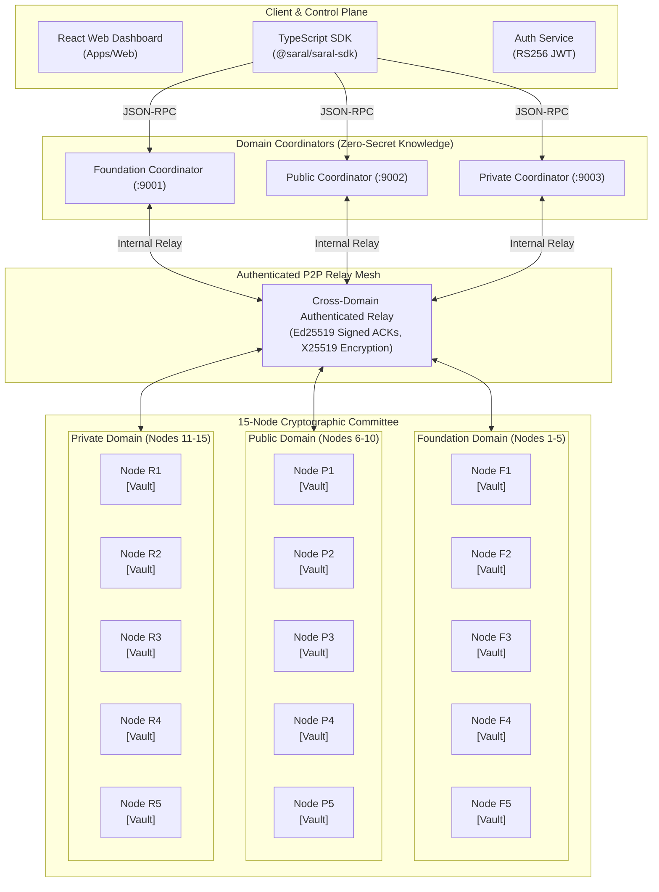

# SARAL Protocol V3 — AVSS & Proactive Cryptosystems Architecture

## 1. Executive Architecture Overview

SARAL Protocol V3 integrates research-grounded **Asynchronous Verifiable Secret Sharing (AVSS)** and **Asynchronous Proactive Share Refresh** based on the seminal paper:

> **"Asynchronous Verifiable Secret Sharing and Proactive Cryptosystems"**  
> *Christian Cachin, Klaus Kursawe, Anna Lysyanskaya, Reto Strobl*  
> ACM Conference on Computer and Communications Security (CCS 2002) / Cryptology ePrint Archive Report 2002/134.

The implementation is integrated directly inside the existing 15-node distributed SARAL V3 Go architecture, preserving the three-domain separation of powers (Foundation, Public, Private), authenticated P2P relay network, Ed25519 node identities, and TLS 1.3/mTLS transport.



---

## 2. Cryptographic Foundations

All finite field arithmetic and elliptic curve group operations are implemented in `services/saral-node/cryptography/` over audited, standard Go cryptographic primitives (`crypto/elliptic`, `crypto/subtle`, `math/big`).

### 2.1 Finite Field $\mathbb{Z}_q$ (`field.go`)

- **Prime Order $q$:** Defined over the prime scalar order of the NIST P-256 (secp256r1) elliptic curve:
  $$q = 2^{256} - 2^{224} + 2^{192} - 8918819107532569059710791020524185946605$$
  In hexadecimal:
  $$q = \mathtt{0xFFFFFFFF00000000FFFFFFFFFFFFFFFFBCE6FAADA7179E84F3B9CAC2FC632551}$$
- **Canonical Scalar Encoding:** 
  - Every scalar is strictly validated upon decoding.
  - Inputs with length $\ne 32$ bytes are rejected with `ErrInvalidScalarLength`.
  - Scalars greater than or equal to $q$ are strictly rejected with `ErrScalarOutOfBounds`. No silent reduction modulo $q$ is permitted.
- **Arithmetic Operations:**
  - Addition, Subtraction, and Multiplication are executed modulo $q$.
  - Inversion $a^{-1} \pmod q$ is computed via the extended Euclidean algorithm (`ModInverse`). Inversion of zero returns `ErrZeroDivision`.
  - Constant-time equality comparison via `subtle.ConstantTimeCompare`.
- **Lagrange Coefficients:**
  - Basis coefficient generation:
    $$\lambda_i(x^*) = \prod_{j \in S, j \ne i} \frac{x^* - x_j}{x_i - x_j} \pmod q$$

### 2.2 Elliptic Curve Group Operations (`group.go`)

- **Primary Generator $G$:** Standard base point of NIST P-256.
- **Secondary Pedersen Generator $H$:** Transparently constructed using Nothing-Up-My-Sleeve (NUMS) trial-and-increment hash-to-curve from the public seed string:
  $$\mathtt{"SARAL\_PEDERSEN\_H\_GENERATOR\_V3\_TRANSPARENT\_NUMS"}$$
  The discrete logarithm $\log_G(H)$ is computationally infeasible to determine, ensuring computational binding and information-theoretic hiding of Pedersen commitments.
- **Pedersen Commitment Scheme:**
  Given value $s \in \mathbb{Z}_q$ and blinding factor $s' \in \mathbb{Z}_q$:
  $$C = s \cdot G + s' \cdot H$$
  Homomorphic property:
  $$\text{Commit}(s_1, s'_1) + \text{Commit}(s_2, s'_2) = \text{Commit}(s_1 + s_2, s'_1 + s'_2)$$
  $$\lambda \cdot \text{Commit}(s, s') = \text{Commit}(\lambda s, \lambda s')$$
- **Point Encoding & Curve Validation:**
  - Points are serialized canonically in 33-byte compressed SEC1 format (`0x02` or `0x03` prefix) or 65-byte uncompressed format (`0x04` prefix).
  - All parsed points must lie on the curve ($y^2 = x^3 - 3x + b \pmod p$). Points at infinity and invalid curve coordinates are rejected with `ErrPointNotOnCurve`.

### 2.3 Randomness & Test Determinism (`randomness.go`)

- **Production Randomness:** `RandScalar()` utilizes cryptographically secure random bytes from `crypto/rand` with rejection sampling modulo $q$, preventing modulo bias.
- **Deterministic Test Vectors:** `DeterministicScalar(seed, index)` derives reproducible test vectors via HMAC-SHA256 expansion, keeping test harnesses isolated from production randomness.

---

## 3. Asynchronous Network Model & Relay Integration

The AVSS protocol engine operates in an **asynchronous network model with Byzantine faults**:
- Network messages may be arbitrarily delayed, reordered, and duplicated by the environment.
- Up to $t$ participants may be actively Byzantine (corrupted, silent, or colluding).
- Communication does not assume synchrony bounds ($\Delta$) or round-based locks.

### 3.1 Relay Infrastructure Reuse

SARAL V3's existing P2P relay network is preserved without disruption:
- Nodes route protocol messages through their local `NodeRelayAdapter`, which delegates to `internal/relay/RelayRouter`.
- Private share slices are transported inside destination-encrypted payloads via X25519 ECDH and ChaCha20-Poly1305.
- Broadcast messages (`AVSS_ECHO`, `AVSS_READY`) are routed across domain coordinators using signed envelope routing.
- Nodes exchange authenticated acknowledgements signed with their Ed25519 identity keys.

### 3.2 Protocol Wire Schemas (`services/saral-node/avss/messages.go`)

All protocol messages bind session ID, committee ID, epoch number, sender node identity, and canonical cryptographic proofs:

| Message Type | Purpose | Payload Fields |
| :--- | :--- | :--- |
| `AVSS_SEND` | Dealer distributes row/column polynomial slices | `SessionID`, `CommitteeID`, `DealerID`, `Epoch`, `RecipientID`, `Commitments` ($k \times k$), `RowPoly`, `RowBlindPoly`, `ColPoly`, `ColBlindPoly` |
| `AVSS_ECHO` | Participant verifies slices and echoes grid point to peer $P_j$ | `SessionID`, `CommitteeID`, `SenderID`, `Epoch`, `CommitmentsHash`, `Interpolated`, `Point` ($a_i(j)$), `BlindPoint` ($a'_i(j)$) |
| `AVSS_READY` | Bracha-style reliable broadcast amplification | `SessionID`, `CommitteeID`, `SenderID`, `Epoch`, `CommitmentsHash`, `Interpolated` |
| `AVSS_SHARED` | Signals local sharing completion | `SessionID`, `CommitteeID`, `NodeID`, `Epoch`, `PublicShareCommitment` |
| `AVSS_RECONSTRUCT` | Test reconstruction share submission | `SessionID`, `CommitteeID`, `NodeID`, `NodeIndex`, `ShareHex`, `BlindShareHex` |

---

## 4. Package Boundaries and Directory Structure

The cryptographic components are structured across clear Go package boundaries under `services/saral-node/`:

```text
services/saral-node/
├── cmd/
│   └── main.go                     # Service wiring, vaults, adapters, HTTP handlers
├── cryptography/
│   ├── field.go                    # Z_q field arithmetic, Lagrange coefficients
│   ├── group.go                    # NIST P-256 operations, Pedersen NUMS generator H
│   ├── randomness.go               # CSPRNG rejection sampling & test seeds
│   └── cryptography_test.go        # Deterministic test vectors & algebraic property tests
├── avss/
│   ├── params.go                   # Parameter validation bounds (n - 2t >= k, k > t)
│   ├── polynomial.go               # Univariate & bivariate polynomials, Horner evaluation
│   ├── commitments.go              # Pedersen commitment matrix C_{j,l}, verification
│   ├── messages.go                 # Wire message structures and JSON serialization
│   ├── session.go                  # Asynchronous AVSS state machine, quorum predicates
│   ├── dealer.go                   # Dealer sharing generation and slice distribution
│   ├── participant.go              # Participant SEND/ECHO/READY processing and verification
│   ├── reconstruction.go           # Isolated verifiable test reconstruction workflow
│   ├── persistence.go              # Atomic session disk metadata persistence
│   ├── engine.go                   # Multi-session orchestrator and relay dispatch
│   └── avss_test.go                # Committee simulations and threshold tests
├── proactive/
│   ├── state.go                    # Epoch state definitions (ACTIVE, REFRESHING, TRANSITIONING)
│   ├── messages.go                 # Proactive agreement wire messages
│   ├── agreement.go                # Asynchronous Validated Byzantine Agreement instance
│   ├── refresh.go                  # Subprotocol re-sharing and Lagrange share update
│   ├── manager.go                  # Epoch manager and stale message gatekeeper
│   ├── recovery.go                 # Epoch discovery and crash recovery
│   └── proactive_test.go           # 15-node refresh and malicious dealer tests
├── vault/
│   └── share_store.go              # AES-256-GCM encrypted persistence, multi-pass wipe
└── internal/
    ├── relay/
    │   ├── adapter.go              # NodeRelayAdapter bridging Engine to RelayRouter
    │   └── router.go               # Relay message handler registration hooks
    └── rpc/
        ├── handler.go              # Standard node RPC handlers
        └── avss_handler.go         # Node AVSS & proactive HTTP endpoints
```

Coordinator-side interfaces are decoupled in `services/coordinator/`:

```text
services/coordinator/
├── cmd/
│   └── main.go                     # Coordinator lifecycle and service wiring
└── internal/
    └── rpc/
        ├── rpc.go                  # JSON-RPC dispatcher and domain handlers
        ├── avss.go                 # saral_createAVSSSession, saral_requestProactiveRefresh
        └── avss_test.go            # Coordinator parameter validation tests
```

---

## 5. Separation of Powers & Zero-Secret Coordinators

A core architectural principle of SARAL Protocol V3 is strict **Separation of Powers**:

1. **Coordinators Do Not Hold Secret Shares:**
   - Domain coordinators are administrative and discovery routers.
   - Coordinators manage participant enrollments, initiate sessions, monitor echo/ready counts, and aggregate public commitments.
   - Plaintext secret shares and polynomial coefficients are **never transmitted to, processed by, or persisted on coordinators**.
2. **Nodes Hold Encrypted Vaults:**
   - Secret shares $s_i$ and blind shares $s'_i$ are stored exclusively on individual node filesystems.
   - Vault files are encrypted using **AES-256-GCM** derived from node-local credentials.
   - Vault files are written with **`0600` permissions** (owner read/write only) using atomic temporary file rename (`.tmp` $\to$ target).
3. **No Dealerless DKG / No TSS Confusion:**
   - In accordance with research specifications, AVSS has an approved dealer for each sharing instance.
   - Section 8 cryptographic stubs (`saral_signTransaction`, `saral_createWallet`, `saral_startDkg`, `saral_getPublicKey`) remain strictly disabled and return `-32000 NOT_IMPLEMENTED`.
   - Standalone AVSS is never misrepresented as dealerless DKG or threshold signature signing.
