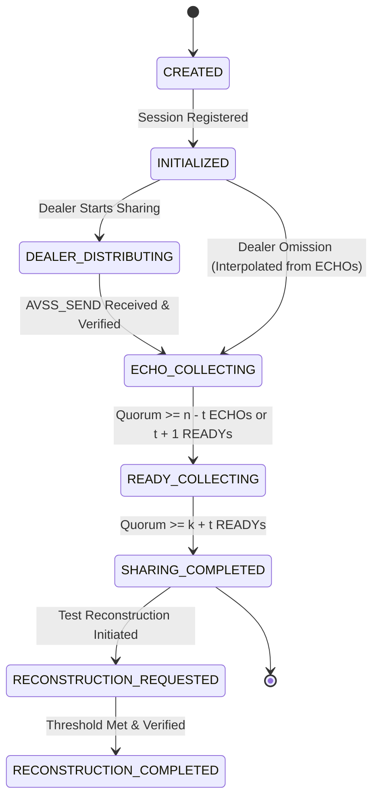

# SARAL Protocol V3 — AVSS Protocol Implementation Specification

## 1. Mathematical Algorithm Specification

The Asynchronous Verifiable Secret Sharing (AVSS) engine in SARAL Protocol V3 directly implements the dual-threshold bivariate polynomial construction of Cachin, Kursawe, Lysyanskaya, and Strobl (ACM CCS 2002).

### 1.1 Symmetric Bivariate Polynomials

Let $\mathbb{Z}_q$ be the finite scalar field of NIST P-256. To share a secret $s \in \mathbb{Z}_q$ with reconstruction threshold $k$:

1. **Secret Polynomial $F(x, y)$:**
   Sample a two-variable polynomial of degree $k - 1$ in each variable:
   $$F(x, y) = \sum_{j=0}^{k-1} \sum_{l=0}^{k-1} F_{j,l} \cdot x^j y^l \pmod q$$
   Subject to:
   - **Secret Binding:** $F(0, 0) = s$.
   - **Symmetry Condition:** $F(x, y) = F(y, x)$, which implies $F_{j,l} = F_{l,j}$ for all $0 \le j, l \le k-1$.
2. **Blinding Polynomial $F'(x, y)$:**
   Sample a blinding bivariate polynomial of degree $k - 1$ in each variable:
   $$F'(x, y) = \sum_{j=0}^{k-1} \sum_{l=0}^{k-1} F'_{j,l} \cdot x^j y^l \pmod q$$
   Subject to:
   - **Blinding Secret:** $F'(0, 0) = s'$ (where $s'$ is a cryptographically secure random scalar).
   - **Symmetry Condition:** $F'_{j,l} = F'_{l,j}$ for all $0 \le j, l \le k-1$.

### 1.2 Row and Column Projections

For each participant $P_i$ with 1-based index $i \in \{1, \dots, n\}$:
- **Row Polynomial:** $a_i(y) = F(i, y) = \sum_{l=0}^{k-1} a_{i,l} \cdot y^l$
- **Row Blinding Polynomial:** $a'_i(y) = F'(i, y) = \sum_{l=0}^{k-1} a'_{i,l} \cdot y^l$
- **Column Polynomial:** $b_i(x) = F(x, i) = \sum_{j=0}^{k-1} b_{i,j} \cdot x^j$
- **Column Blinding Polynomial:** $b'_i(x) = F'(x, i) = \sum_{j=0}^{k-1} b'_{i,j} \cdot x^j$

Due to bivariate symmetry:
$$a_i(x) \equiv b_i(x) \quad \text{and} \quad a'_i(x) \equiv b'_i(x)$$
Furthermore, for any pair of participants $P_i$ and $P_j$:
$$a_i(j) = F(i, j) = F(j, i) = b_j(i) = a_j(i)$$
This symmetry allows participants to cross-verify overlapping grid points without revealing their entire polynomial slices.

### 1.3 Pedersen Commitment Matrix

The dealer constructs a $k \times k$ matrix of elliptic curve commitments in NIST P-256:
$$C_{j,l} = F_{j,l} \cdot G + F'_{j,l} \cdot H \quad (0 \le j, l \le k-1)$$
where $G$ is the standard base generator and $H$ is the transparent NUMS generator.

- **Secret Commitment:**
  $$C_{0,0} = F_{0,0} \cdot G + F'_{0,0} \cdot H = s \cdot G + s' \cdot H$$
- **Evaluation Point Commitment $C(x, y)$:**
  For any coordinates $(x, y) \in \mathbb{Z}_q^2$, the commitment to $F(x, y)$ is computed homomorphically:
  $$C(x, y) = \sum_{j=0}^{k-1} \sum_{l=0}^{k-1} (x^j y^l) \cdot C_{j,l}$$
- **Row Commitment $A_i(y)$:**
  $$A_{i,l} = \sum_{j=0}^{k-1} i^j \cdot C_{j,l} \implies A_i(y) = \sum_{l=0}^{k-1} y^l \cdot A_{i,l}$$

---

## 2. Asynchronous State Machine & Message Flow

The AVSS protocol transitions through distinct asynchronous states in `services/saral-node/avss/session.go`:

### 2.1 Step-by-Step Protocol Stages

#### Stage 1: Dealer Distribution (`AVSS_SEND`)
1. Approved dealer $P_d$ samples $F(x, y)$ and $F'(x, y)$ with secret $s$ and blinding $s'$.
2. Dealer computes commitment matrix $C_{j,l}$ ($0 \le j, l < k$).
3. For each participant $P_i$ ($1 \le i \le n$), dealer evaluates:
   - Row polynomials: $a_i(y), a'_i(y)$
   - Column polynomials: $b_i(x), b'_i(x)$
4. Dealer constructs `AVSS_SEND` message and transmits it to $P_i$ via the encrypted relay.

#### Stage 2: Verification and Echo Broadcast (`AVSS_ECHO`)
1. Participant $P_i$ receives `AVSS_SEND` and verifies:
   - Dimension: Commitment matrix is exactly $k \times k$.
   - Row Polynomial Verification:
     $$\forall l \in [0, k-1]: \quad \text{Commit}(a_{i,l}, a'_{i,l}) \stackrel{?}{=} \sum_{j=0}^{k-1} i^j \cdot C_{j,l}$$
   - Column Polynomial Verification:
     $$\forall j \in [0, k-1]: \quad \text{Commit}(b_{i,j}, b'_{i,j}) \stackrel{?}{=} \sum_{l=0}^{k-1} i^l \cdot C_{j,l}$$
2. If verified, $P_i$ computes grid point for peer $P_j$:
   $$p_{i,j} = a_i(j) \quad \text{and} \quad p'_{i,j} = a'_i(j)$$
3. $P_i$ transmits `AVSS_ECHO` to each peer $P_j$ containing $(p_{i,j}, p'_{i,j})$ and the commitments hash.

#### Stage 3: Echo Verification and Fallback Interpolation
1. When $P_j$ receives `AVSS_ECHO` from $P_i$, it verifies the point against the commitment matrix:
   $$\text{Commit}(p_{i,j}, p'_{i,j}) \stackrel{?}{=} C(i, j)$$
2. **Symmetry Consistency Check:**
   If $P_j$ already holds its row polynomial $a_j(y)$, it checks:
   $$b_j(i) = a_j(i) \stackrel{?}{=} p_{i,j}$$
3. **Fallback for Byzantine Dealer Omission:**
   If the dealer failed to send `AVSS_SEND` to $P_j$, $P_j$ collects verified points $p_{i,j}$ from incoming `AVSS_ECHO` messages. Upon accumulating $k$ valid points from distinct participants, $P_j$ reconstructs its row polynomial via Lagrange interpolation:
   $$a_j(y) = \text{InterpolateUnivariate}(\{(i, p_{i,j})\}_{i \in \text{Points}})$$
   $P_j$ marks its slice as `Interpolated = true`.

#### Stage 4: Ready Amplification (`AVSS_READY`)
$P_i$ sends an `AVSS_READY` message to all peers when **either** of the following conditions is satisfied:
1. $P_i$ has collected valid `AVSS_ECHO` messages from at least $n - t$ distinct participants; **OR**
2. $P_i$ has received valid `AVSS_READY` messages from at least $t + 1$ distinct participants (Bracha amplification).

#### Stage 5: Sharing Completion Predicate
$P_i$ transitions to `SHARING_COMPLETED` and derives its share when:
$$\text{Received READYs} \ge k + t$$
At this point:
1. $P_i$ computes its private secret share:
   $$S_i = a_i(0) = F(i, 0)$$
   $$S'_i = a'_i(0) = F'(i, 0)$$
2. $P_i$ computes its public share commitment:
   $$Q_i = C(i, 0) = S_i \cdot G + S'_i \cdot H$$
3. $P_i$ atomically writes $(S_i, S'_i)$ into its encrypted vault (`0600` permissions).
4. $P_i$ broadcasts `AVSS_SHARED` containing its public commitment $Q_i$ (no secret material).

---

## 3. Verifiable Share Reconstruction (Isolated Test Workflow)

Reconstruction is implemented strictly as a controlled cryptographic test verification workflow (`services/saral-node/avss/reconstruction.go`). It is **disabled for production keys**.

### 3.1 Verification Steps Before Interpolation

Given a candidate set of submitted shares $\{(i, S_i, S'_i)\}$:
1. **Threshold Check:** Reject immediately if $|\text{shares}| < k$.
2. **Duplicate Check:** Ensure all indices $i$ are distinct.
3. **Commitment Verification:** For each share $(S_i, S'_i)$, verify against the column commitment:
   $$\text{Commit}(S_i, S'_i) \stackrel{?}{=} C(i, 0)$$
   If any share fails, the reconstruction routine terminates with `ErrInvalidShareCommitment` and identifies the fraudulent participant.

### 3.2 Lagrange Interpolation at $x = 0$

Using $k$ verified shares, compute the Lagrange basis polynomials at $x = 0$:
$$\lambda_i = \prod_{j \in S, j \ne i} \frac{0 - j}{i - j} = \prod_{j \in S, j \ne i} \frac{-j}{i - j} \pmod q$$

Recover the candidate secret and blinding scalar:
$$\hat{s} = \sum_{i \in S} \lambda_i S_i \pmod q$$
$$\hat{s}' = \sum_{i \in S} \lambda_i S'_i \pmod q$$

### 3.3 Proof Verification Against $C_{0,0}$

Compute the reconstructed Pedersen commitment:
$$\hat{C} = \text{Commit}(\hat{s}, \hat{s}') = \hat{s} \cdot G + \hat{s}' \cdot H$$
Check:
$$\hat{C} \stackrel{?}{=} C_{0,0}$$
If the equation holds, the master secret $s$ is cryptographically verified to have been reconstructed with absolute fidelity.
