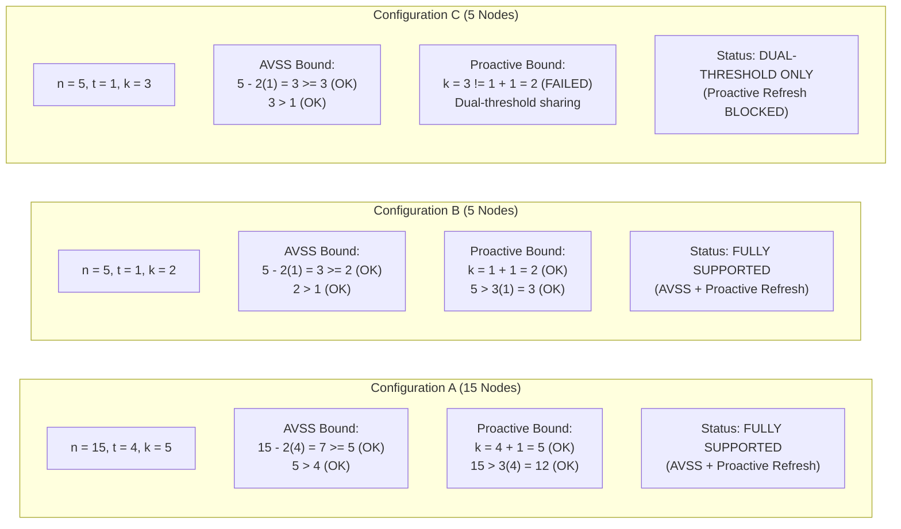

# SARAL Protocol V3 — AVSS & Proactive Security Model

## 1. Mathematical Security Parameters

SARAL Protocol V3 maintains distinct definitions for all cryptographic security parameters to avoid model confusion:

| Parameter | Meaning | Constraints |
| :---: | :--- | :--- |
| **$n$** | Total number of participants in the cryptographic committee | $n \ge 4$ |
| **$k$** | Reconstruction threshold (minimum valid shares required to reconstruct the secret) | $k \ge 2$ |
| **$t$** | Byzantine corruption bound (maximum actively malicious, colluding, or silent nodes tolerated) | $t \ge 1$ |
| **$f$** | Crash fault bound (fail-stop nodes, only where explicitly specified in hybrid models) | $f \ge 0$ |

---

## 2. Theoretical Bound Validations

### 2.1 Cachin et al. Dual-Threshold AVSS Bounds

In the primary research reference:
> **"Asynchronous Verifiable Secret Sharing and Proactive Cryptosystems"**  
> *Christian Cachin, Klaus Kursawe, Anna Lysyanskaya, Reto Strobl (ACM CCS 2002)*

The asynchronous verifiable secret sharing protocol achieves dual-threshold security under the strict conditions:

$$n - 2t \ge k$$
$$k > t$$

#### Mathematical Derivation of the Dual-Threshold Bound:
1. **Liveness / Reconstruction Quorum:** Any honest participant must be able to complete sharing and obtain its share even if $t$ Byzantine nodes refuse to cooperate. Furthermore, in an asynchronous network, up to $t$ additional honest messages may be delayed. Therefore, the protocol must make progress after receiving messages from $n - t$ participants.
2. **Bracha Reliable Broadcast Quorum:** A participant can send `AVSS_READY` upon receiving $n - t$ valid `AVSS_ECHO` messages, or upon receiving $t + 1$ `AVSS_READY` messages (amplification).
3. **Completion Predicate:** A participant terminates and computes its share only after receiving $k + t$ valid `AVSS_READY` messages. Because at most $t$ of these ready messages can originate from Byzantine nodes, at least:
   $$(k + t) - t = k$$
   of the ready messages are guaranteed to come from honest nodes.
4. **Sufficient Slices for Reconstruction:** For the honest nodes to collectively possess at least $k$ points to reconstruct the bivariate polynomial $F(x, y)$, the total number of honest participants that will eventually complete must satisfy $n - 2t \ge k$.

### 2.2 Cachin et al. Ordinary Proactive Refresh Bounds

The proactive share refresh protocol described in Section 4 of Cachin et al. (CCS 2002) is constructed strictly for **ordinary $(t+1)$-out-of-$n$ sharings**:

$$k = t + 1$$
$$n > 3t$$

#### Why Dual-Threshold Sharings Do Not Inherit the Proactive Refresh Proof:
In the proactive refresh protocol:
1. Each node $P_i$ acts as a dealer in an AVSS subprotocol, sharing its existing share $s_i^{(\tau)}$ using a polynomial $h_i(x)$ of degree $k - 1$.
2. The participants run an Asynchronous Validated Byzantine Agreement instance to agree on a subset $S^*$ of dealers whose sharings completed.
3. The validity predicate $V(S^*)$ requires $|S^*| \ge 2t + 1$ dealers to ensure that honest nodes hold a majority of contributions.
4. When $k = t + 1$, any subset of $2t + 1$ nodes contains at least $t + 1 = k$ honest nodes, which is sufficient to reconstruct and interpolate the secret without ever opening it:
   $$s_j^{(\tau+1)} = \sum_{i \in S^*} \lambda_i s_{i,j} \pmod q$$
5. **When $k > t + 1$ (e.g. Configuration C where $k=3, t=1$):**
   The linear combination of sub-shares does not satisfy the ordinary sharing invariance proof of Cachin et al. without introducing higher-degree agreement predicates that require an increased quorum of $n > 4t$.
   **SARAL strictly prohibits claiming that dual-threshold sharings with $k \ne t + 1$ automatically support the Cachin et al. proactive refresh construction.**

### 2.3 Distinction from HybridDKG / HybridVSS Bounds

Secondary literature, such as Kate, Huang, Goldberg (*"Distributed Key Generation in the Wild"*, 2012), considers a hybrid fault model separating Byzantine faults ($t$) from crash faults ($f$):

$$n \ge 3t + 2f + 1$$

SARAL Protocol V3 distinguishes between the two papers:
- Cachin et al. (2002) governs the core AVSS engine and proactive refresh implementation.
- Kate et al. (2012) represents an alternative crash-tolerant hybrid bound, but is **not** conflated with the pure Byzantine model of Cachin et al.

---

## 3. Evaluation of Committee Configurations

SARAL V3 formally evaluates three committee configurations:



### Detailed Configuration Breakdown:

#### Configuration A: Full 15-Node POC Cluster
- **Parameters:** $n = 15$, $t = 4$, $k = 5$
- **AVSS Dual-Threshold Validation:**
  - $n - 2t = 15 - 2(4) = 7 \ge 5$ (Satisfied)
  - $k > t \implies 5 > 4$ (Satisfied)
- **Proactive Refresh Validation:**
  - $k = t + 1 \implies 5 = 4 + 1$ (Satisfied: Ordinary sharing)
  - $n > 3t \implies 15 > 3(4) = 12$ (Satisfied)
- **Security Assessment:** **Fully Supported.** Supports full AVSS bivariate sharing, asynchronous quorum convergence, and research-grounded proactive share refresh across epochs.

#### Configuration B: Minimal 5-Node Ordinary Committee
- **Parameters:** $n = 5$, $t = 1$, $k = 2$
- **AVSS Dual-Threshold Validation:**
  - $n - 2t = 5 - 2(1) = 3 \ge 2$ (Satisfied)
  - $k > t \implies 2 > 1$ (Satisfied)
- **Proactive Refresh Validation:**
  - $k = t + 1 \implies 2 = 1 + 1$ (Satisfied: Ordinary sharing)
  - $n > 3t \implies 5 > 3(1) = 3$ (Satisfied)
- **Security Assessment:** **Fully Supported.** Minimal ordinary configuration suitable for single-domain testing.

#### Configuration C: 5-Node Dual-Threshold Only Committee
- **Parameters:** $n = 5$, $t = 1$, $k = 3$
- **AVSS Dual-Threshold Validation:**
  - $n - 2t = 5 - 2(1) = 3 \ge 3$ (Satisfied)
  - $k > t \implies 3 > 1$ (Satisfied)
- **Proactive Refresh Validation:**
  - $k = t + 1 \implies 3 \ne 1 + 1 = 2$ (**VIOLATED**)
- **Security Assessment:** **Dual-Threshold AVSS Supported; Proactive Refresh Blocked.**
  Configuration C satisfies the AVSS sharing bounds, allowing valid bivariate sharing and test reconstruction. However, attempts to invoke `saral_requestProactiveRefresh` on Configuration C are strictly rejected with an explicit error:
  ```text
  "proactive refresh rejected: Cachin et al. proactive refresh strictly requires ordinary sharing with k = t + 1 (got k=3, t=1). Configuration C (k > t+1) dual-threshold AVSS does not support the research paper's proactive refresh protocol"
  ```

---

## 4. Committee vs. Physical Domain Classification

In SARAL V3, nodes are physically partitioned across three administrative domains:
- **Foundation Domain:** Nodes `saral-foundation-1` through `saral-foundation-5`
- **Public Domain:** Nodes `saral-public-1` through `saral-public-5`
- **Private Domain:** Nodes `saral-private-1` through `saral-private-5`

### Critical Architectural Principle:
**Physical domain membership does not automatically enforce a per-domain cryptographic threshold policy.**
- The mathematical committee is defined solely by the committee participant set $\{P_1, \dots, P_n\}$ and the parameters $(n, k, t)$.
- A 15-node committee spans 5 nodes from Foundation, 5 from Public, and 5 from Private.
- Corruption of up to $t$ nodes anywhere in the committee (even all 4 within a single physical domain, or distributed across domains) does not compromise the secrecy of the master secret ($< k$) or prevent honest nodes from completing the sharing ($n - 2t \ge k$).

---

## 5. Adversary Model & Threat Analysis

SARAL V3 models an active Byzantine adversary that can corrupt up to $t$ nodes:

| Threat Scenario | Attack Mechanism | Protocol Defense & Security Invariant |
| :--- | :--- | :--- |
| **Dishonest Dealer (Inconsistent Slices)** | Dealer sends inconsistent polynomial slices $a_i(y)$ and $a_j(y)$ such that $a_i(j) \ne a_j(i)$. | Slices are validated against the commitment matrix: $\text{Commit}(a_i(j), a'_i(j)) = C(i, j)$. Participants exchange `AVSS_ECHO` messages containing point $a_i(j)$. If $a_i(j) \ne a_j(i)$, honest nodes will not send `AVSS_READY`. |
| **Selective Dealer Omission** | Dealer withholds `AVSS_SEND` from honest node $P_i$. | Node $P_i$ collects verified grid points $a_j(i)$ from peer `AVSS_ECHO` messages. Once $k$ valid points are collected, $P_i$ interpolates its row polynomial $a_i(y) = \text{Interpolate}(\{a_j(i)\})$ and joins the sharing. |
| **Forged Share Scalars** | A Byzantine participant submits an arbitrary scalar during test reconstruction. | Every share $S_i$ is verified against the public column commitment: $\text{Commit}(S_i, S'_i) \stackrel{?}{=} C(i, 0)$. Forged scalars fail verification and are discarded. |
| **Sub-threshold Collusion** | An adversary corrupts up to $k - 1$ participants and pools their shares. | Information-theoretic hiding: Blinding polynomial $F'(x, y)$ perfectly masks the secret polynomial $F(x, y)$ in the discrete log setting. Any $k - 1$ shares have uniform probability across all possible secrets. |
| **Stale Epoch / Replay Attacks** | Adversary re-injects messages from epoch $\tau$ during epoch $\tau + 1$. | Every message binds `Epoch`. The proactive manager strictly rejects any message where $\text{msg.Epoch} < \text{activeEpoch}$. |
| **Old Share Recovery after Compromise** | Adversary compromises a node host after epoch $\tau$ has completed. | Multi-pass cryptographic wiping: Old epoch $\tau$ shares are overwritten with random bytes and zeros before being deleted (`SecureEraseEpoch`). |
