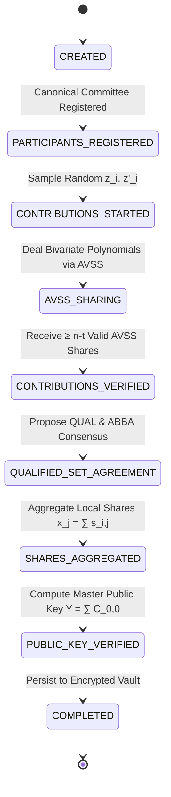

# SARAL Protocol V3 — Dealerless Distributed Key Generation (DKG) Architecture

**Document Version:** 1.0.0  
**Phase:** Phase 3 — Dealerless Distributed Key Generation (DKG)  
**Status:** IMPLEMENTED & CRYPTOGRAPHICALLY VERIFIED  
**Research References:**
1. *“Distributed Key Generation in the Wild”* — Aniket Kate, Yizhou Huang, Ian Goldberg (ACM ASIACCS 2012 / IACR Cryptology ePrint Archive: Report 2012/377).
2. *“Asynchronous Verifiable Secret Sharing and Proactive Cryptosystems”* — Christian Cachin, Klaus Kursawe, Anna Lysyanskaya, Reto Strobl (ACM CCS 2002 / IACR Cryptology ePrint Archive: Report 2002/134).

---

## 1. Executive Summary & Architectural Overview

In SARAL Protocol V3, cryptographic master keys are never generated by a centralized entity, single administrator, or trusted dealer. Instead, initial key generation is executed via a **Dealerless Asynchronous Distributed Key Generation (DKG)** protocol directly embedded inside the Go node processes across three administrative domains: **Foundation**, **Public**, and **Private**.

Every participating node independently samples a random secret contribution $z_i \in_R \mathbb{Z}_N$ (where $N$ is the NIST P-256 elliptic curve group order) and acts as an AVSS dealer to distribute verifiable shares of $z_i$ across all committee peers. Through an asynchronous agreement protocol over the verifiable shares, the committee establishes a deterministic **Qualified Set ($QUAL^*$)** of valid contributors ($|QUAL^*| \ge n - t$).

Each honest node $P_j$ locally aggregates its received shares into its active master key share:
$$x_j = \sum_{i \in QUAL^*} s_{i, j} \pmod N, \quad x'_j = \sum_{i \in QUAL^*} s'_{i, j} \pmod N$$
The group master public key is derived identically and deterministically by all honest participants:
$$Y = \sum_{i \in QUAL^*} C^{(i)}_{0, 0} = x \cdot G \in \mathbb{E}(\mathbb{F}_P)$$
At no point in the protocol is the master private key $x = \sum_{i \in QUAL^*} z_i \pmod N$ centralized, reconstructed, or revealed to any coordinator, operator, or network intermediary.

```
                              ┌────────────────────────────────────────┐
                              │  Coordinator (Orchestration & Status)  │
                              │  STRICT PRIVACY: NEVER SEES SHARES     │
                              └───────────────────┬────────────────────┘
                                                  │
                 ┌────────────────────────────────┼────────────────────────────────┐
                 ▼                                ▼                                ▼
    ┌─────────────────────────┐      ┌─────────────────────────┐      ┌─────────────────────────┐
    │  Foundation Domain      │      │  Public Domain          │      │  Private Domain         │
    │  Nodes 1..5             │◄────►│  Nodes 6..10            │◄────►│  Nodes 11..15           │
    │  Local P-256 AVSS       │      │  Local P-256 AVSS       │      │  Local P-256 AVSS       │
    │  AES-256-GCM Vault      │      │  AES-256-GCM Vault      │      │  AES-256-GCM Vault      │
    └─────────────────────────┘      └─────────────────────────┘      └─────────────────────────┘
                 ▲                                ▲                                ▲
                 └────────────────────────────────┴────────────────────────────────┘
                          Authenticated P2P Relay Mesh (TLS 1.3 / mTLS)
```

---

## 2. Separation of Powers & Threat Model

SARAL Protocol V3 enforces strict Separation-of-Powers boundaries across architectural components:

1. **Go Node Processes (`services/saral-node`):**
   - Execute all cryptographic operations: P-256 scalar arithmetic, bivariate polynomial sampling, Pedersen commitment generation, symmetric bivariate equality verification, ABBA Byzantine consensus, and share aggregation.
   - Maintain persistent, encrypted local storage (`vault.ShareStore`) protected by AES-256-GCM under node-specific vault keys with POSIX `0600` file permissions.
   - Never expose raw private shares $x_j$ or blinding factors $x'_j$ over RPC endpoints, coordinator interfaces, or logging streams.

2. **Domain Coordinators (`services/coordinator`):**
   - Provide REST and JSON-RPC APIs for operators to trigger protocol sessions (`saral_startDkg`) and inspect public progress (`saral_getDkgStatus`, `saral_getDkgPublicKey`).
   - Monitor and route encrypted P2P relay envelopes across domain boundaries.
   - **Zero-Knowledge Guarantee:** Coordinators receive only public commitments ($C^{(i)}_{0,0}$), verification status flags, and session metadata. A compromised coordinator learns nothing about private shares or master keys.

3. **Verifiers (`services/verifier`) & Auth Server (`apps/auth-server`):**
   - Enforce cryptographic mTLS 1.3 identity, verify RS256 operator JWT tokens, and authorize high-privilege administrative actions.
   - Verifiers operate fail-closed: if verifiers are unreachable, coordinator RPC handlers immediately reject requests.

---

## 3. Committee Configurations & Theoretical Fault Bounds

The protocol supports two standardized committee topologies satisfying all theoretical bounds from Kate et al. (2012) and Cachin et al. (2002):

### Theoretical Bounds
- **Byzantine Agreement Bound:** $n > 3t$ (required for asynchronous Byzantine consensus and termination).
- **AVSS Reconstruction Bound:** $n - 2t \ge k$ (guarantees that $n-t$ honest nodes can reconstruct despite $t$ corrupted nodes).
- **Fault Tolerance Bound:** $k \ge t + 1$ (prevents $t$ colluding adversaries from reconstructing the secret).
- **Qualified Set Bound:** $|QUAL^*| \ge n - t$ (in asynchronous networks, at most $n - t$ dealers are guaranteed to terminate before agreement).

### Configuration Parameters

| Committee Profile | Committee ID | Total Nodes ($n$) | Fault Tolerance ($t$) | Threshold ($k$) | Consensus Bound ($n > 3t$) | Reconstruction Bound ($n - 2t \ge k$) | Min Qualified Set ($|QUAL^*| \ge n - t$) |
|---|---|---|---|---|---|---|---|
| **Global Cross-Domain** | `saral-global-15` | **15** | **4** | **5** | $15 > 12$ ✅ | $15 - 8 = 7 \ge 5$ ✅ | $\ge 11$ nodes |
| **Single Domain** | `saral-foundation-5` | **5** | **1** | **2** | $5 > 3$ ✅ | $5 - 2 = 3 \ge 2$ ✅ | $\ge 4$ nodes |

---

## 4. DKG Protocol State Machine

Each node session executes an asynchronous state machine with deterministic transitions:



---

## 5. Seamless Hand-off to Proactive Refresh

A critical architectural requirement is seamless compatibility between Dealerless DKG (Phase 3) and Asynchronous Proactive Share Refresh (Phase 2):

1. **Epoch 1 Output:** DKG terminates by outputting an active secret share record at Epoch 1:
   $$\text{ShareRecord}(\tau = 1, x_j, x'_j, Y)$$
2. **Epoch Transition ($\tau \to \tau + 1$):**
   When Proactive Refresh is triggered, node $P_j$ uses its active share $x_j$ as the input secret to a new zero-sharing bivariate AVSS subprotocol with threshold $k = t + 1$.
3. **Invariance:**
   Because both DKG and Proactive Refresh operate over NIST P-256 with identical Pedersen commitment bases $(G, H)$, the refreshed share $\hat{x}_j$ satisfies:
   $$\hat{x}_j \cdot G + \hat{x}'_j \cdot H = Q_j^{(\tau+1)}$$
   The master secret $x$ and master public key $Y$ remain completely unchanged across all future epochs without ever being reconstructed.
4. **Forward Secrecy:**
   Upon successful agreement on Epoch $\tau+1$, all Epoch $\tau$ shares are securely zeroized in memory and removed from persistent storage.

---

## 6. Directory Layout & Key Modules

```
services/saral-node/dkg/
├── types.go           # DKG state definitions, message payloads, fault validation
├── session.go         # Node DKG session state machine, share aggregation, vault persistence
├── engine.go          # Relay message dispatch and AVSS completion listeners
└── dkg_test.go        # Cryptographic unit tests (5-node, 15-node, malicious dealer, proactive handoff)

tests/dkg/
├── go.mod             # Module configuration for standalone integration test suite
└── dkg_integration_test.go # E2E tests: 15-node committee, 4 Byzantine faults, crash & restart recovery

services/coordinator/internal/rpc/
└── dkg.go             # Coordinator JSON-RPC endpoints (saral_startDkg, saral_getDkgStatus, etc.)
```
