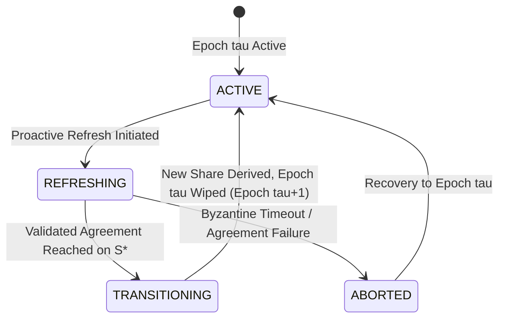

# SARAL Protocol V3 — Proactive Share Refresh Implementation Specification

## 1. Asynchronous Proactive Model

The proactive share refresh engine in SARAL Protocol V3 implements the asynchronous proactive cryptosystem model of Cachin et al. (ACM CCS 2002, Section 4).

### 1.1 Epoch States and Lifecycle

Each node maintains an independent proactive lifecycle state machine (`services/saral-node/proactive/state.go`):

| State | Description |
| :--- | :--- |
| `ACTIVE` | Normal operating mode. Node holds active share $s_j^{(\tau)}$ for epoch $\tau$. |
| `REFRESHING` | Node is executing subprotocol AVSS instances and exchanging sub-shares for epoch $\tau + 1$. |
| `TRANSITIONING` | Validated Agreement reached on candidate set $S^*$. Computing refreshed share and erasing epoch $\tau$ share. |
| `ABORTED` | Refresh aborted due to Byzantine timeout or invalid agreement proposal. |

### 1.2 Phase Boundaries & Replay Protection

1. **Epoch Metadata Binding:** Every proactive protocol message binds:
   `{ CommitteeID, Epoch, SenderID, MessageType, Nonce }`
2. **Stale Epoch Gating:** When a node is in epoch $\tau$:
   - Any message with $\text{msg.Epoch} < \tau$ is **immediately dropped** and logged as `ErrStaleEpoch`.
   - Any message with $\text{msg.Epoch} > \tau + 1$ is buffered or rejected to prevent premature phase leaps.
3. **Replay Deduplication:** Nonces are retained in memory with a rolling expiration window.

---

## 2. Subprotocol AVSS Dealing Stage

In epoch $\tau$, each participant $P_i$ possesses:
- Secret share: $s_i^{(\tau)}$
- Blinding share: $s_{i}^{\prime (\tau)}$
- Public share commitment: $Q_i^{(\tau)} = \text{Commit}(s_i^{(\tau)}, s_{i}^{\prime (\tau)}) = C(i, 0)$

To transition to epoch $\tau + 1$, each node $P_i$ acts as a dealer in an independent AVSS subprotocol:
1. $P_i$ generates random symmetric bivariate polynomials $h_i(x, y)$ and $h'_i(x, y)$ of degree $k - 1$:
   $$h_i(0, 0) = s_i^{(\tau)} \quad \text{and} \quad h'_i(0, 0) = s_{i}^{\prime (\tau)}$$
2. $P_i$ computes subprotocol commitment matrix $C^{(i)}_{j,l}$ for $0 \le j, l < k$:
   $$C^{(i)}_{j,l} = \text{Commit}(h_{i,j,l}, h'_{i,j,l})$$
   Notice that the constant term commitment matches $P_i$'s public commitment from epoch $\tau$:
   $$C^{(i)}_{0,0} = h_i(0, 0) \cdot G + h'_i(0, 0) \cdot H = s_i^{(\tau)} \cdot G + s_{i}^{\prime (\tau)} \cdot H = Q_i^{(\tau)}$$
3. $P_i$ distributes subprotocol row slices to each participant $P_j$:
   $$s_{i,j} = h_i(0, j) \quad \text{and} \quad s'_{i,j} = h'_i(0, j)$$
4. Participants run standard AVSS sharing on each subprotocol instance.

---

## 3. Asynchronous Validated Byzantine Agreement

To ensure all honest nodes combine the exact same subset of subprotocol sharings, participants execute an **Asynchronous Validated Multi-Valued Byzantine Agreement** (`services/saral-node/proactive/agreement.go`).

### 3.1 External Validity Predicate $V(S)$

A proposed candidate set of completed dealers $S \subseteq \{P_1, \dots, P_n\}$ is externally valid if and only if:
1. **Quorum Size:**
   $$|S| \ge 2t + 1$$
2. **Cryptographic Share Commitment Consistency:**
   For every dealer $d \in S$:
   - The subprotocol sharing for $P_d$ must have completed locally on the verifier.
   - The subprotocol secret commitment must match the previously accepted epoch $\tau$ share commitment:
     $$C^{(d)}_{0,0} \stackrel{?}{=} Q_d^{(\tau)}$$
   This prevents a corrupted dealer from sharing an arbitrary value rather than its actual share $s_d^{(\tau)}$.

### 3.2 Two-Phase Agreement Protocol

1. **PROPOSAL:** Proposer broadcasts `PROACTIVE_AGREEMENT_PROPOSE` containing candidate set $S$.
2. **ECHO:** Upon receiving proposal $S$, participant verifies $V(S)$. If valid, participant broadcasts `PROACTIVE_AGREEMENT_ECHO(S)`.
3. **READY:**
   - Upon receiving $n - t$ valid `PROACTIVE_AGREEMENT_ECHO(S)` messages; **OR**
   - Upon receiving $t + 1$ valid `PROACTIVE_AGREEMENT_READY(S)` messages (amplification),  
   participant broadcasts `PROACTIVE_AGREEMENT_READY(S)`.
4. **DECISION:**
   Upon receiving $2t + 1$ matching `PROACTIVE_AGREEMENT_READY(S)` messages, participant outputs decision $S^*$ and initiates transition.

---

## 4. Refreshed Share Derivation

Once agreement on candidate set $S^*$ is reached:

1. **Lagrange Interpolation Coefficients:**
   For each dealer $i \in S^*$, compute the Lagrange coefficient at $x = 0$ over the index set $S^*$:
   $$\lambda_i = \prod_{j \in S^*, j \ne i} \frac{0 - j}{i - j} = \prod_{j \in S^*, j \ne i} \frac{-j}{i - j} \pmod q$$

2. **Compute New Refreshed Share for Participant $P_j$:**
   $$s_j^{(\tau+1)} = \sum_{i \in S^*} \lambda_i \cdot s_{i,j} \pmod q$$
   $$s_{j}^{\prime (\tau+1)} = \sum_{i \in S^*} \lambda_i \cdot s'_{i,j} \pmod q$$

3. **Compute New Public Share Commitment:**
   $$Q_j^{(\tau+1)} = \text{Commit}(s_j^{(\tau+1)}, s_{j}^{\prime (\tau+1)}) = \sum_{i \in S^*} \lambda_i \cdot C^{(i)}(0, j)$$

---

## 5. Mathematical Proof of Secret Invariance

### Theorem (Master Secret Invariance Across Epochs)
*Let $s$ be the master secret shared in epoch $\tau$, and let $s_j^{(\tau+1)}$ be the refreshed shares computed in epoch $\tau + 1$ over an agreed set $S^*$ with $|S^*| \ge 2t + 1$. Then:*
1. *Any $k$ refreshed shares in epoch $\tau + 1$ reconstruct the original master secret $s$.*
2. *The public commitment to the master secret $C_{0,0}$ remains invariant across all epochs.*
3. *Individual shares $s_j^{(\tau+1)}$ are freshly randomized and reveal no information about past or future shares.*

### Proof:
By definition, each subprotocol polynomial $h_i(x, y)$ satisfies:
$$h_i(0, 0) = s_i^{(\tau)}$$
Because the master secret $s$ was shared using a polynomial of degree $k - 1 = t$, and $|S^*| \ge 2t + 1 \ge k$, the set $S^*$ contains more than enough points to reconstruct the secret:
$$s = \sum_{i \in S^*} \lambda_i s_i^{(\tau)} = \sum_{i \in S^*} \lambda_i h_i(0, 0) \pmod q$$

Now consider the refreshed share polynomial in epoch $\tau + 1$:
$$F^{(\tau+1)}(x, y) = \sum_{i \in S^*} \lambda_i h_i(x, y) \pmod q$$

Evaluating $F^{(\tau+1)}$ at $(0, 0)$:
$$F^{(\tau+1)}(0, 0) = \sum_{i \in S^*} \lambda_i h_i(0, 0) = \sum_{i \in S^*} \lambda_i s_i^{(\tau)} = s$$

Evaluating $F^{(\tau+1)}$ at $(j, 0)$ gives the refreshed share of participant $P_j$:
$$F^{(\tau+1)}(j, 0) = \sum_{i \in S^*} \lambda_i h_i(j, 0) = \sum_{i \in S^*} \lambda_i h_i(0, j) = \sum_{i \in S^*} \lambda_i s_{i,j} = s_j^{(\tau+1)}$$

By the homomorphic property of Pedersen commitments:
$$C_{0,0}^{(\tau+1)} = \sum_{i \in S^*} \lambda_i C^{(i)}_{0,0} = \sum_{i \in S^*} \lambda_i Q_i^{(\tau)} = \sum_{i \in S^*} \lambda_i \left(s_i^{(\tau)} G + s_{i}^{\prime (\tau)} H\right) = s \cdot G + s' \cdot H = C_{0,0}^{(\tau)}$$

Thus, the master secret $s$ and its public Pedersen commitment $C_{0,0}$ remain **identically invariant** without ever opening or reconstructing the master secret. $\blacksquare$

---

## 6. Secure Share Erasure & Vault Migration

To protect against mobile adversaries that compromise different nodes in different epochs, old shares must be irretrievably erased (`services/saral-node/vault/share_store.go`):

1. **Atomic Write of Epoch $\tau + 1$ Share:**
   - Refreshed share $(s_j^{(\tau+1)}, s_{j}^{\prime (\tau+1)})$ is encrypted with AES-256-GCM.
   - Written to temporary file `share_<committee>_epoch_<tau+1>.json.tmp`.
   - Atomically renamed to `share_<committee>_epoch_<tau+1>.json` with `0600` permissions.
2. **Cryptographic Erasure of Epoch $\tau$ Share (`SecureEraseEpoch`):**
   - The epoch $\tau$ vault file is opened in `O_WRONLY` mode.
   - **Pass 1:** Overwritten with cryptographically secure pseudorandom bytes.
   - **Pass 2:** Overwritten with all zeros (`0x00`).
   - Synced to disk via `file.Sync()`.
   - File is unlinked (`os.Remove`).
3. **State Transition Completion:**
   - Active epoch counter is incremented to $\tau + 1$.
   - Proactive manager logs `EPOCH_TRANSITION_COMPLETED`.
