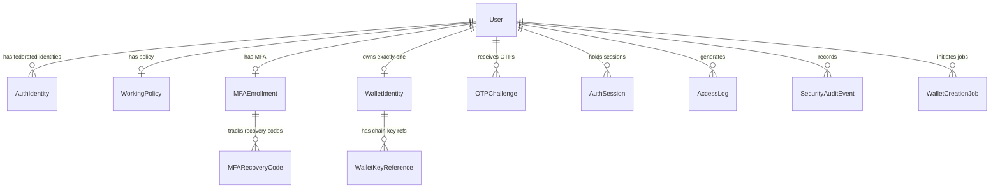
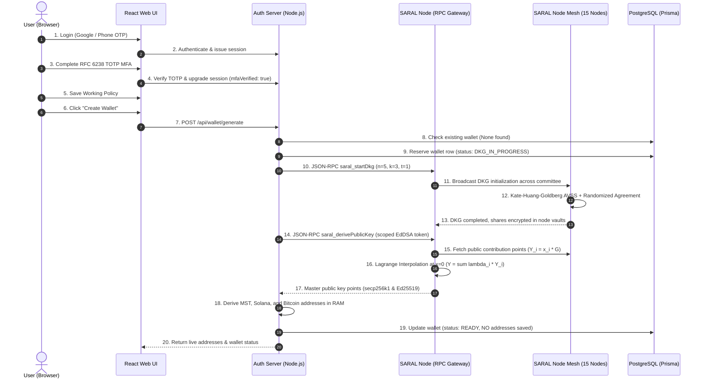
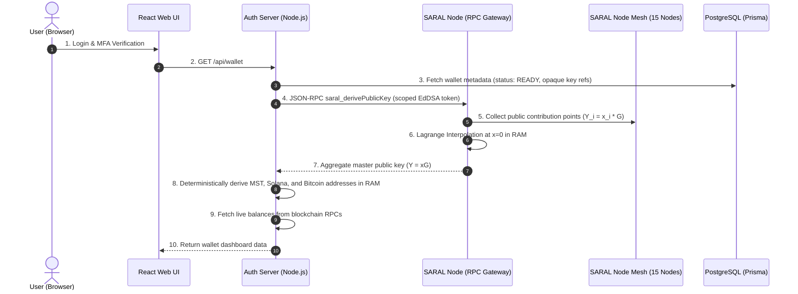

# SARAL PROTOCOL — COMPLETE ARCHITECTURE & SYSTEM SPECIFICATION

> **Authoritative Technical Architecture & System Specification**  
> **Repository:** `saral-poc` | **Branch:** `saral-mohit-new`  
> **Topology:** 2 Component Architecture | 3 Domains | 15 Distributed Go Nodes | Direct P2P Mesh  
> **Status:** Production-Verified | Dealerless DKG | Zero Central Key Persistence | Coordinator & Verifier Removed  

---

## 1. System Overview

**SARAL Protocol** (Separation-of-Powers Cryptographic Key Infrastructure) is a high-assurance, dealerless threshold-cryptography protocol and multi-chain Web3 wallet architecture.

The SARAL POC operates strictly using a streamlined **2-component architecture**:
1. **Web2 Authentication System (`apps/auth-server`)**: User registration, login (Google OAuth 2.0 & Phone OTP), RFC 6238 TOTP Multi-Factor Authentication (MFA), session management, working policy evaluation, and user-to-wallet mapping.
2. **SARAL Node (`services/saral-node`)**: Decentralized dealerless DKG, Kate-Huang-Goldberg Asynchronous Verifiable Secret Sharing (AVSS), proactive secret sharing, direct P2P mesh relay, encrypted key-share vault storage, in-process Ed25519 token verification, and threshold cryptographic operations.

All Coordinator and Verifier standalone microservice nodes have been **permanently removed**. The SARAL nodes communicate peer-to-peer over an authenticated direct mesh, verify JWT tokens in-process, and expose direct JSON-RPC and REST gateways.

### Core Architectural Guarantees:
1. **No Single Entity Holds Private Keys:** Private signing keys are never created, assembled, or persisted on any server, client device, or database.
2. **Dealerless Key Generation (DKG):** Distributed key shares are generated collaboratively across 15 independent Go microservice nodes using Kate-Huang-Goldberg Asynchronous Verifiable Secret Sharing (AVSS) and Randomized Byzantine Consensus.
3. **Multi-Chain Native Compatibility:** Real aggregate public key points derive standard addresses for **MST Testnet (EVM / secp256k1)**, **Solana Devnet (Ed25519)**, and **Bitcoin Testnet (Taproot Bech32m / secp256k1)**.
4. **Authoritative Access Gates:** High-security login with RFC 6238 TOTP Multi-Factor Authentication (MFA) and Authoritative Time/Location Working Policy geofencing.
5. **Zero Central Key & Address Persistence:** PostgreSQL persists zero private keys, zero public keys, and zero wallet addresses. Addresses are derived on demand in volatile RAM from verified public polynomial points.

---

## 2. Three-Domain Separation of Powers

To prevent collusion, administrative overreach, and single-cloud compromise, the network topology is strictly divided into three sovereign administrative realms comprising 15 SARAL nodes:

```mermaid
graph TD
    subgraph ThreeDomains ["SARAL Protocol — Three-Domain Separation of Powers (2-Component Architecture)"]
        subgraph FoundationDomain ["1. Foundation Domain (Governance & Genesis)"]
            NF1["saral-foundation-1\n(Port 8001 / RPC)"]
            NF2["saral-foundation-2"]
            NF3["saral-foundation-3"]
            NF4["saral-foundation-4"]
            NF5["saral-foundation-5"]
        end

        subgraph PublicDomain ["2. Public Domain (Auditing & Community)"]
            NP1["saral-public-1\n(Port 8002 / RPC)"]
            NP2["saral-public-2"]
            NP3["saral-public-3"]
            NP4["saral-public-4"]
            NP5["saral-public-5"]
        end

        subgraph PrivateDomain ["3. Private Domain (Enterprise & Regulated)"]
            NR1["saral-private-1\n(Port 8003 / RPC)"]
            NR2["saral-private-2"]
            NR3["saral-private-3"]
            NR4["saral-private-4"]
            NR5["saral-private-5"]
        end
    end

    FoundationDomain <-->|Direct P2P Mesh Relay| PublicDomain
    PublicDomain <-->|Direct P2P Mesh Relay| PrivateDomain
    PrivateDomain <-->|Direct P2P Mesh Relay| FoundationDomain
```



1. **Foundation Domain (`FOUNDATION`):** 5 nodes governing committee membership, genesis participants, and core quorum sessions.
2. **Public Domain (`PUBLIC`):** 5 independent nodes operating as community participants and decentralized relay points.
3. **Private Domain (`PRIVATE`):** 5 isolated enterprise and compliance nodes ensuring cross-institutional oversight.

No single domain possesses enough nodes ($k=3$) to reconstruct or sign without cross-domain consensus.

---

## 3. Frontend Architecture

The client presentation layer is a React 18 single-page application built with Vite and Tailwind CSS (`apps/web`):

```text
apps/web/
├── src/
│   ├── app/                 # Routing, router guards, layouts, context providers
│   │   ├── guards/          # RequireAuth, RequireMfa, RequirePolicy, PublicOnly
│   │   ├── layouts/         # AppLayout, AuthLayout
│   │   └── router.tsx       # Route tree definitions
│   ├── features/            # Feature-sliced UI modules
│   │   ├── auth/            # LoginForm, Mfa, useSession
│   │   ├── wallet/          # Wallet dashboard, SendPanel, ReceivePanel, useWalletQueries
│   │   ├── policy/          # WorkingPolicy setup, Review
│   │   ├── activity/        # Activity transaction feeds
│   │   └── settings/        # Security settings and identity
│   ├── services/            # Pure HTTP API clients (httpClient, authApi, walletApi)
│   ├── shared/              # Reusable UI primitives, hooks, formatters
│   │   ├── ui/              # Button, Card, Badge, Modal, Amount, AddressText
│   │   ├── hooks/           # useBreakpoint, useLocation, useTheme
│   │   └── lib/             # JWT claims decoder, local session store, formatters
│   └── main.tsx             # Application bootstrap
```

### Core UI Principles:
- **Zero-Secret Client:** The browser never receives, handles, or requests raw cryptographic scalars or private shares.
- **Fail-Closed State Machine:** Routes enforce session gates: `anonymous` $\to$ `needs-mfa` $\to$ `needs-policy` $\to$ `ready`.
- **Responsive Multi-Chain View:** Simultaneously displays live balances and receive QR codes for MSTC, SOL, and Testnet BTC.

---

## 4. Auth Server Architecture (Component 1)

The Authentication & Orchestration Server is a TypeScript service running on Node.js 20+ with Express and Prisma ORM (`apps/auth-server`):

```text
apps/auth-server/
├── prisma/
│   ├── schema.prisma        # PostgreSQL relational schema
│   └── migrations/          # Version-controlled SQL migrations
├── src/
│   ├── auth/                # Asymmetric Ed25519 token manager (KeyManager) & JWKS
│   ├── clients/             # Typed JSON-RPC saralBackendClient for direct SARAL Node communication
│   ├── config/              # Centralized environment & administrative auth config
│   ├── database/            # Singleton PrismaClient connection lifecycle
│   ├── middleware/          # authGuard, requireMfa, policyGuard, errorHandler
│   ├── routes/              # Express REST routes (auth.ts, wallet.ts)
│   ├── services/            # accountService, walletService, policyService, chainService
│   ├── storage/             # DataStore unified RAM cache with async Prisma persistence
│   ├── utils/               # EIP-55, Base58, Bech32m, TOTP cryptography utils
│   ├── app.ts               # Express application initialization & middleware stack
│   └── server.ts            # Server bootstrap, port binding, graceful shutdown
```

### Responsibilities:
- User registration and login (Google OAuth 2.0 with PKCE and development Phone OTP).
- RFC 6238 TOTP Multi-Factor Authentication enrollment and verification.
- Session management via JWT with cryptographic expiration and revocation.
- Working policy schedule and geofence evaluation.
- Direct JSON-RPC communication with SARAL Node gateways (`saral_startDkg`, `saral_getDkgStatus`, `saral_derivePublicKey`).
- Multi-chain address derivation in volatile RAM.

---

## 5. SARAL Node Architecture (Component 2)

Implemented in Go in `services/saral-node`:

```text
services/saral-node/
├── cmd/
│   └── main.go              # Node entrypoint, HTTP/RPC server, signal handling
├── dkg/
│   ├── engine.go            # Kate-Huang-Goldberg dealerless DKG engine
│   └── types.go             # DKG protocol messages and state models
├── avss/
│   └── avss.go              # Asynchronous Verifiable Secret Sharing implementation
├── proactive/
│   └── refresh.go           # Periodic proactive secret share rotation
├── internal/
│   ├── auth/
│   │   ├── verifier.go      # In-process Ed25519 token verification (NodeTokenVerifier)
│   │   └── auth.go          # Internal authentication and token validation
│   ├── crypto/
│   │   ├── curve_helpers.go # Secp256k1 & Ed25519 point math, Lagrange interpolation
│   │   └── e2e.go           # Wire encryption and destination-bound ECDH
│   ├── identity/
│   │   └── manager.go       # Persistent node identity (Ed25519 signing + X25519 enc)
│   ├── p2p/
│   │   └── manager.go       # Peer connection tracking and mesh gossip
│   ├── relay/
│   │   ├── router.go        # Direct P2P relay router with recipient-signed ACKs
│   │   └── types.go         # Relay message schemas and routing traces
│   └── rpc/
│       └── jsonrpc.go       # Direct JSON-RPC gateway for DKG and relay operations
└── vault/
    └── share_store.go       # Local AES-256-GCM encrypted key share vault
```

### Responsibilities:
- **Autonomous DKG Participation:** Generates random polynomial contributions $F_i(x,y)$ and Pedersen commitment matrices.
- **Encrypted Share Vault:** Persists private key shares strictly within local AES-256-GCM encrypted vaults (`/vault`).
- **Direct P2P Mesh Relay:** Peer-to-peer authenticated message routing across domains without intermediaries.
- **In-Process Auth Verification:** `NodeTokenVerifier` validates scoped EdDSA operator JWTs directly using Auth Server public keys.
- **Lagrange Interpolation in RAM:** Reconstructs aggregate master public points $Y = \sum \lambda_i Y_i$ upon authorized requests without assembling private shares.
- **JSON-RPC Gateway:** Exposes `/rpc` handling `saral_startDkg`, `saral_getDkgStatus`, `saral_derivePublicKey`, `saral_getNodeStatus`, and `saral_sendRelayMessage`.

---

## 6. Prisma / PostgreSQL Data Ownership & Clean Schema

Central relational state is managed strictly through PostgreSQL 16 via Prisma ORM (`apps/auth-server/prisma/schema.prisma`):

| Table Name | Model Name | Purpose & Security Scope |
| :--- | :--- | :--- |
| **`users`** | `User` | Core user identity (Google ID, mobile, email, login method). |
| **`auth_identities`** | `AuthIdentity` | Normalized federated OAuth provider links (Google, Mobile). |
| **`mfa`** | `MFAEnrollment` | MFA enrollment with AES-256 encrypted TOTP secret (`totp_secret_encrypted`) and SHA-256 hashed recovery codes. Plaintext secrets strictly eliminated. |
| **`mfa_recovery_codes`**| `MFARecoveryCode` | Normalized single-use recovery code hashes and redemption timestamps. |
| **`work_policy`** | `WorkingPolicy` | Geofence coordinates, allowed radius (km), time windows, days of week, and active policy flags. |
| **`otps`** | `OTPChallenge` | Phone OTP challenges with HMAC-SHA256 hashed code, purpose, expiration, and used flag. |
| **`auth_sessions`** | `AuthSession` | Active session tokens with JTI, expiration, revocation state, and MFA-verified flag. |
| **`wallets`** | `WalletIdentity` | Strict 1:1 user-to-logical-wallet mapping with opaque JSON key references. **Zero addresses, public keys, or private keys.** |
| **`wallet_key_references`**| `WalletKeyReference` | Normalized per-chain active key references (`wallet_id`, `chain`, `key_ref`). |
| **`wallet_creation_jobs`** | `WalletCreationJob` | Asynchronous DKG generation job lifecycle tracking (`PENDING`, `PROCESSING`, `COMPLETED`, `FAILED`). |
| **`security_event_logs`** | `SecurityAuditEvent` | Tamper-evident hash-chained security event audit log (`previous_hash`, `entry_hash`). |
| **`access_logs`** | `AccessLog` | Policy authorization attempt records with coordinates, decision, and evaluation reason. |



### Data Architecture Invariants:
1. **Zero Address & Key Storage:** The central database persists **ZERO private keys, ZERO public keys, and ZERO blockchain addresses**. It stores only opaque identifiers (`key-mst-...`, `key-sol-...`, `key-btc-...`, `dkgSessionId`).
2. **On-Chain Transaction Derivation:** Transaction histories are queried live from blockchain RPC networks (`chainService.ts`) rather than stored centrally.
3. **Zero Plaintext MFA Secrets:** Plaintext TOTP secrets and recovery codes are strictly disallowed. Only `totp_secret_encrypted` (AES-256) and `recovery_codes_hashed` (SHA-256) are retained.

---

## 7. Secure Internal Communication & Authentication

1. **Direct P2P Mesh Relay:** Inter-node message exchange occurs directly via `/p2p/relay` and `/node/relay/send` over authenticated HTTP/TLS channels.
2. **In-Process Token Verification:** The Auth Server issues scoped Ed25519 JWT tokens signed with its private key (`auth_ed25519_private_key.pem`). SARAL nodes verify these tokens in-process via `NodeTokenVerifier` using the matching public key (`auth_public_key.pem`).
3. **Scoped Authorization:** Tokens bind specific user, wallet, session, and operation scopes to prevent replay or privilege escalation:
   ```json
   {
     "sub": "user-uuid",
     "walletId": "wal-uuid",
     "keyId": "key-mst-uuid",
     "sessionId": "dkg-foundation-uuid",
     "operation": "derive_public_key",
     "mfaVerified": true,
     "policySatisfied": true,
     "iss": "saral-auth-server",
     "aud": "saral-node-committee",
     "exp": 1795259900
   }
   ```

---

## 8. First-Time User Wallet Creation Sequence



---

## 9. Returning-User Sequence



---

## 10. Dealerless DKG & AVSS Cryptography

The SARAL DKG is **dealerless**: no single party ever generates or reconstructs the master secret.
- **Contribution Phase:** Every node $P_i$ picks a random private scalar $z_i \in \mathbb{F}_q$ and blinding factor $z'_i$.
- **Bivariate Polynomial:** Node $P_i$ constructs a random symmetric bivariate polynomial of degree $k-1 = 2$:
  $$F_i(x, y) = \sum_{j=0}^{k-1} \sum_{l=0}^{k-1} a_{j,l} x^j y^l$$
- **Pedersen Commitments:** Node $P_i$ computes commitment matrix:
  $$C_{j,l}^{(i)} = a_{j,l} \cdot G + b_{j,l} \cdot H$$
- **Consensus on Contributors:** Nodes exchange shares over the P2P mesh and use Randomized Asynchronous Binary Byzantine Agreement (ABBA) to finalize an agreed Qualified Set of contributors $\text{QUAL}^*$.
- **Aggregate Master Key:** The collective secret $x = \sum_{i \in \text{QUAL}^*} z_i$, and the group master signing public key:
  $$Y = \sum_{i \in \text{QUAL}^*} C_{0,0}^{(i)} = x \cdot G$$
- **Proactive Share Refresh:** Nodes periodically rotate shares without changing the underlying master public key or wallet addresses.

---

## 11. Multi-Chain Address Derivation (Volatile RAM)

Multi-chain addresses are derived deterministically in RAM from verified master public keys:

1. **MST Testnet (EVM):**
   - **Curve:** Secp256k1
   - **Derivation:** Uncompressed public key point $(X, Y) \to$ Keccak-256 hash $\to$ take last 20 bytes $\to$ apply EIP-55 mixed-case checksum.
   - **Format:** `0x...` (42 characters).

2. **Solana Devnet:**
   - **Curve:** Ed25519
   - **Derivation:** Compressed 32-byte Ed25519 point $\to$ Base58 encoding.
   - **Format:** Standard 32-44 character Base58 string.

3. **Bitcoin Testnet:**
   - **Curve:** Secp256k1
   - **Derivation:** BIP-341 Taproot output-key tweak ($Q = P + \text{hash}_{\text{TapTweak}}(P) \cdot G$) $\to$ BIP-350 Bech32m witness version 1 encoding with prefix `tb`.
   - **Format:** `tb1p...` (62 characters).

---

## 12. Wallet Address Zero-Persistence Policy

| Data Item | Stored in PostgreSQL? | Stored on SARAL Nodes? | Where Does It Live? |
| :--- | :---: | :---: | :--- |
| **Private Signing Key ($x$)** | ❌ NEVER | ❌ NEVER | **Never exists anywhere** |
| **Private Key Share ($x_i$)** | ❌ NEVER | ✅ Encrypted | Local node `/vault` (AES-256-GCM) |
| **Master Public Key ($Y$)** | ❌ NEVER | ❌ NEVER | Recomputed in RAM on demand |
| **EVM Address (MST)** | ❌ NEVER | ❌ NEVER | Derived in RAM on demand |
| **Solana Address** | ❌ NEVER | ❌ NEVER | Derived in RAM on demand |
| **Bitcoin Address** | ❌ NEVER | ❌ NEVER | Derived in RAM on demand |
| **Opaque Key References** | ✅ YES | ❌ NO | PostgreSQL `wallets` table |

Even in the event of a total database dump or server seizure, an attacker cannot extract any blockchain addresses or private keys.

---

## 13. Docker Container Topology (2-Component Architecture)

The production environment is defined in `infra/compose/poc15.yml` and `infra/compose/full24.yml`:

```text
Container Name                        Port(s)      Component Type
--------------------------------------------------------------------------------------
saral-postgres                        5432         PostgreSQL 16 Relational Store
saral-auth-server                     3001         Web2 Authentication System
saral-node-f1..f5                     8001..8005   5 Foundation SARAL Nodes
saral-node-p1..p5                     8006..8010   5 Public SARAL Nodes
saral-node-r1..r5                     8011..8015   5 Private SARAL Nodes
saral-web                             80, 5173     Frontend Web UI
--------------------------------------------------------------------------------------
Coordinator Containers:               NONE (Permanently Removed)
Verifier Containers:                  NONE (Permanently Removed)
```

---

## 14. Test and Validation Suite

The repository maintains an automated, multi-tiered test suite:
1. **TypeScript Security & Derivation Suite (`tests/architecture/wallet_lifecycle_security.test.ts`):** Verifies 3-of-5 DKG address derivation, zero DB persistence, fail-closed behavior, and concurrent idempotency.
2. **Prisma Integration Suite (`tests/architecture/prisma_integration.test.ts`):** Validates relational integrity, cascade behavior, and model constraints.
3. **Auth & Policy Suite (`tests/architecture/auth_policy_wallet.test.ts`):** Covers TOTP MFA, working policy geofencing, and session transitions.
4. **Backend Client Suite (`tests/architecture/backend_client.test.ts`):** Validates `SaralBackendClient` communicating directly with SARAL Node endpoints.
5. **Direct Node Architecture Suite (`tests/architecture/architecture_test.go`):** 8-step integration test validating the 2-component architecture without Coordinator or Verifier.
6. **Direct Node P2P Mesh Relay Suite (`tests/architecture/relay_test.go`):** 11-step integration test verifying 15 nodes, direct P2P mesh relay, 6 cross-domain paths, recipient-signed ACKs, unknown peer rejection, forged sender rejection, replay protection, and crash restart recovery.
7. **Cryptographic Suite (`tests/avss`, `tests/dkg`, `tests/proactive`, `tests/cryptography`, `tests/integration`):** Full end-to-end verification of Kate-Huang-Goldberg AVSS, dealerless DKG, randomized agreement, and proactive refresh secret invariance.
