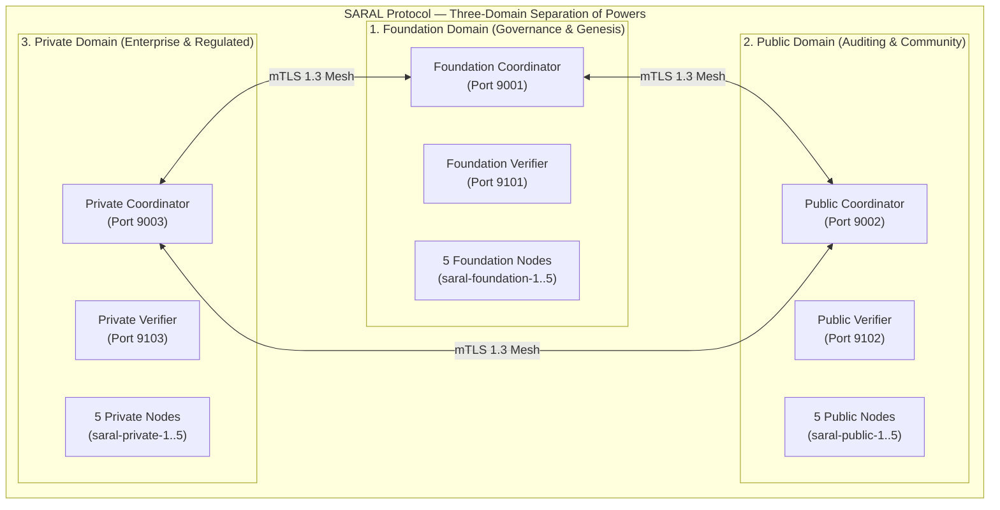
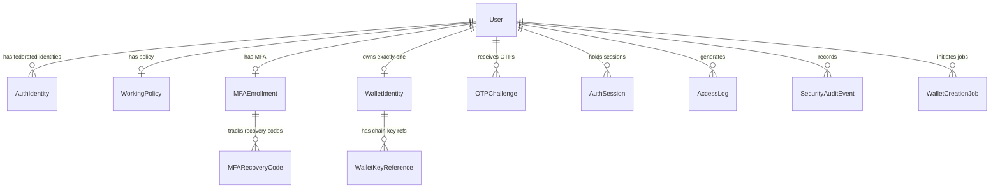
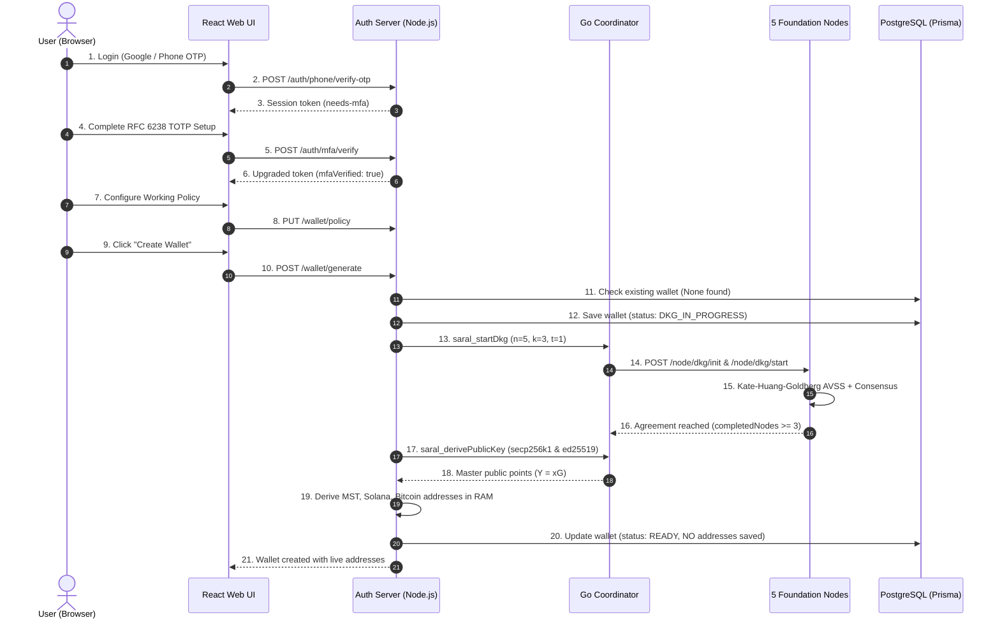
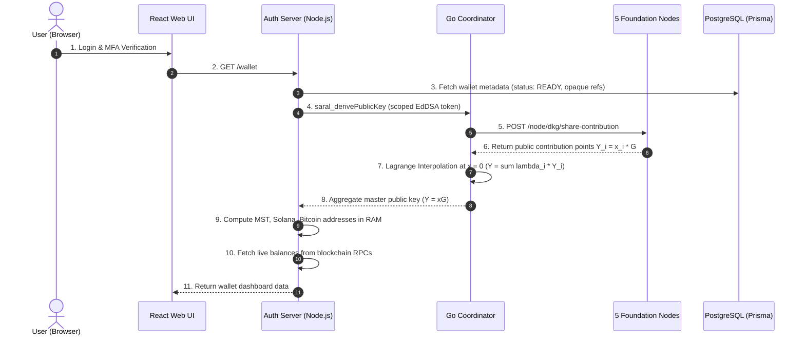
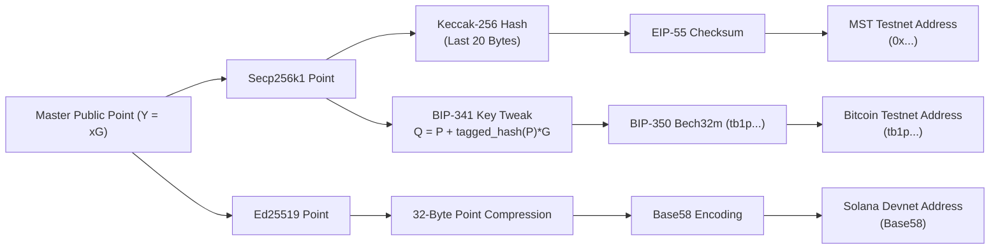

# SARAL PROTOCOL — COMPLETE ARCHITECTURE & SYSTEM SPECIFICATION

> **Authoritative Technical Architecture & System Specification**  
> **Repository:** `saral-poc` | **Branch:** `saral-dkg`  
> **Topology:** 3 Domains | 15 Distributed Go Nodes | 24-Container Mesh  
> **Status:** Production-Verified | Dealerless DKG | Zero Central Key Persistence  

---

## 1. System Overview

**SARAL Protocol** (Separation-of-Powers Cryptographic Key Infrastructure) is a high-assurance, dealerless threshold-cryptography protocol and multi-chain Web3 wallet architecture.

In traditional custodial wallets, private keys are stored centrally in databases or HSMs. In traditional self-custody wallets, a single seed phrase represents a single point of failure and loss. SARAL eliminates both failure modes:
1. **No Single Entity Holds Private Keys:** Private signing keys are never created, assembled, or persisted on any server, client device, or database.
2. **Dealerless Key Generation (DKG):** Distributed key shares are generated collaboratively across 15 independent Go microservice nodes using Kate-Huang-Goldberg Asynchronous Verifiable Secret Sharing (AVSS) and Randomized Byzantine Consensus.
3. **Multi-Chain Native Compatibility:** Real aggregate public key points derive standard addresses for **MST Testnet (EVM)**, **Solana Devnet (Ed25519)**, and **Bitcoin Testnet (Taproot Bech32m)**.
4. **Authoritative Access Gates:** High-security login with RFC 6238 TOTP Multi-Factor Authentication (MFA) and Authoritative Time/Location Working Policy geofencing.

---

## 2. Three-Domain Separation of Powers

To prevent collusion, administrative overreach, and single-cloud compromise, the network topology is strictly divided into three sovereign administrative realms:



1. **Foundation Domain (`FOUNDATION`):** Governs committee membership, genesis participants, and core quorum sessions.
2. **Public Domain (`PUBLIC`):** Independent nodes operating as decentralized verifiers and public relay points.
3. **Private Domain (`PRIVATE`):** Isolated enterprise and compliance nodes ensuring cross-institutional oversight.

No single domain possesses enough nodes ($k=3$) to reconstruct or sign without cross-domain consensus.

---

## 3. Frontend Architecture

The client presentation layer is a React 18 single-page application built with Vite and Tailwind CSS (`apps/web`):

```text
apps/web/
├── src/
│   ├── app/                 # Routing, router guards, layouts, context providers
│   │   ├── guards/          # RequireAuth, RequireMfa, RequirePolicy, PublicOnly
│   │   ├── layouts/         # AppLayout, AuthLayout
│   │   └── router.tsx       # Route tree definitions
│   ├── features/            # Feature-sliced UI modules
│   │   ├── auth/            # LoginForm, Mfa, useSession
│   │   ├── wallet/          # Wallet dashboard, SendPanel, ReceivePanel, useWalletQueries
│   │   ├── policy/          # WorkingPolicy setup, Review
│   │   ├── activity/        # Activity transaction feeds
│   │   └── settings/        # Security settings and identity
│   ├── services/            # Pure HTTP API clients (httpClient, authApi, walletApi)
│   ├── shared/              # Reusable UI primitives, hooks, formatters
│   │   ├── ui/              # Button, Card, Badge, Modal, Amount, AddressText
│   │   ├── hooks/           # useBreakpoint, useLocation, useTheme
│   │   └── lib/             # JWT claims decoder, local session store, formatters
│   └── main.tsx             # Application bootstrap
```

### Core UI Principles:
- **Zero-Secret Client:** The browser never receives, handles, or requests raw cryptographic scalars.
- **Fail-Closed State Machine:** Routes enforce session gates: `anonymous` $\to$ `needs-mfa` $\to$ `needs-policy` $\to$ `ready`.
- **Responsive Multi-Chain View:** Simultaneously displays live balances and receive QR codes for MSTC, SOL, and Testnet BTC.

---

## 4. Auth Server Architecture

The Authentication & Orchestration Server is a TypeScript service running on Node.js 20+ with Express and Prisma ORM (`apps/auth-server`):

```text
apps/auth-server/
├── prisma/
│   ├── schema.prisma        # PostgreSQL relational schema
│   └── migrations/          # Version-controlled SQL migrations
├── src/
│   ├── auth/                # Asymmetric Ed25519 token manager (KeyManager) & JWKS
│   ├── clients/             # Typed JSON-RPC saralBackendClient for Go Coordinator
│   ├── config/              # Centralized environment & administrative auth config
│   ├── database/            # Singleton PrismaClient connection lifecycle
│   ├── middleware/          # authGuard, requireMfa, policyGuard, errorHandler
│   ├── routes/              # Express REST routes (auth.ts, wallet.ts)
│   ├── services/            # accountService, walletService, policyService, chainService
│   ├── storage/             # DataStore unified RAM cache with async Prisma persistence
│   ├── utils/               # EIP-55, Base58, Bech32m, TOTP cryptography utils
│   ├── app.ts               # Express application initialization & middleware stack
│   └── server.ts            # Server bootstrap, port binding, graceful shutdown
```

---

## 5. Prisma / PostgreSQL Data Ownership & Clean Schema

Central relational state is managed strictly through PostgreSQL 16 via Prisma ORM (`apps/auth-server/prisma/schema.prisma`). In accordance with SARAL's Zero-Persistence & Minimal Relational Architecture, all legacy demo tables (`transactions`), plaintext fields (`mfa.secret`, `mfa.recovery_codes`), and seed scripts (`seed.ts`) have been permanently removed.

### Active PostgreSQL Tables (12 Canonical Tables)

| Table Name | Model Name | Purpose & Security Scope |
| :--- | :--- | :--- |
| **`users`** | `User` | Core user identity (Google ID, mobile, email, login method). |
| **`auth_identities`** | `AuthIdentity` | Normalized federated OAuth provider links (Google, Mobile). |
| **`mfa`** | `MFAEnrollment` | MFA enrollment with AES-256 encrypted TOTP secret (`totp_secret_encrypted`) and SHA-256 hashed recovery codes. Plaintext secrets strictly eliminated. |
| **`mfa_recovery_codes`**| `MFARecoveryCode` | Normalized single-use recovery code hashes and redemption timestamps. |
| **`work_policy`** | `WorkingPolicy` | Geofence coordinates, allowed radius (km), time windows, and active policy flags. |
| **`otps`** | `OTPChallenge` | Phone OTP challenges with HMAC-SHA256 hashed code, purpose, expiration, and used flag. |
| **`auth_sessions`** | `AuthSession` | Active session tokens with JTI, expiration, revocation state, and MFA-verified flag. |
| **`wallets`** | `WalletIdentity` | Strict 1:1 user-to-logical-wallet mapping with opaque JSON key references. **Zero addresses, public keys, or private keys.** |
| **`wallet_key_references`**| `WalletKeyReference` | Normalized per-chain active key references (`wallet_id`, `chain`, `key_ref`). |
| **`wallet_creation_jobs`** | `WalletCreationJob` | Asynchronous DKG generation job lifecycle tracking (`PENDING`, `PROCESSING`, `COMPLETED`, `FAILED`). |
| **`security_event_logs`** | `SecurityAuditEvent` | Tamper-evident hash-chained security event audit log (`previous_hash`, `entry_hash`). |
| **`access_logs`** | `AccessLog` | Policy authorization attempt records with coordinates, decision, and evaluation reason. |



### Data Architecture Invariants:
1. **Zero Address & Key Storage:** The central database persists **ZERO private keys, ZERO public keys, and ZERO blockchain addresses**. It stores only opaque identifiers (`key-mst-...`, `key-sol-...`, `key-btc-...`, `dkgSessionId`).
2. **On-Chain Transaction Derivation:** The legacy `transactions` table has been removed. Transaction histories are queried live from blockchain RPC networks (`chainService.ts`) rather than stored centrally.
3. **Zero Plaintext MFA Secrets:** Plaintext TOTP secrets and recovery codes are strictly disallowed. Only `totp_secret_encrypted` (AES-256) and `recovery_codes_hashed` (SHA-256) are retained.
4. **Zero-Seed Startup (No Demo Data):** The application contains no mock users, fake wallets, or `seed.ts` dependencies. Fresh databases initialize cleanly via `npm run prisma:migrate`. Real users and wallets bootstrap exclusively through authenticated OAuth, OTP, and genuine Go Coordinator DKG runs.

---

## 6. Go Coordinator Responsibilities

Implemented in `services/coordinator`:
- **Consensus Orchestration:** Directs multi-node DKG sessions (`saral_startDkg`).
- **Session Tracking:** Tracks node contributions, secret commitments, and committee state.
- **Lagrange Interpolation in RAM:** Reconstructs aggregate master public points $Y = \sum \lambda_i Y_i$ upon authorized requests without handling private shares.
- **Relay Dispatching:** Coordinates authenticated inter-domain message routing across TLS 1.3 connections.

---

## 7. Go Node Responsibilities

Implemented in `services/saral-node`:
- **Autonomous DKG Participation:** Generates random polynomial contributions $F_i(x,y)$ and Pedersen commitment matrices.
- **Encrypted Share Vault:** Persists private key shares strictly within local AES-256-GCM encrypted vaults (`/vault`).
- **P2P Relay Mesh:** Direct peer-to-peer authenticated message exchange with replay protection.
- **Share Contribution Handlers:** Evaluates scoped operator tokens and issues authorized public contribution points $Y_i = x_i \cdot G$.

---

## 8. Verifier Responsibilities

Implemented in `services/verifier`:
- **Stateless Authorization Gate:** Validates operator tokens and JWT claims against Auth Server JWKS endpoints.
- **Fail-Closed Gatekeeper:** If a Verifier goes offline or rejects a token, Coordinators immediately reject RPC requests with code `-32001`.
- **Role Verification:** Enforces strict role boundaries (`operator`, `node`, `admin`).

---

## 9. Secure Internal Communication

Inter-service and inter-node communication employs a multi-tiered security mesh:
1. **Node-to-Node:** Mutual TLS (mTLS 1.3) with X.509 client and server certificates signed by a cluster Certificate Authority (`infra/tls/ca.crt`).
2. **Auth-Server to Coordinator:** JSON-RPC over HTTP with short-lived scoped Ed25519 bearer tokens signed by the Auth Server.
3. **Coordinator to Node:** Authenticated HTTP with internal bearer tokens (`/run/secrets/saral_internal_token`).

---

## 10. EdDSA / JWKS Authentication

Authentication between the Node.js Auth Server and Go services uses asymmetric Ed25519 (EdDSA) cryptography:
1. **Key Generation:** Persistent Ed25519 keypair (`auth_ed25519_private.key` / `auth_public_key.pem`).
2. **JWKS Endpoint:** `GET /.well-known/jwks.json` exposes public keys with key rotation metadata (`kid: saral-auth-key-2026-01`, `kty: OKP`, `crv: Ed25519`).
3. **Scoped Tokens:** Tokens bind specific user, wallet, and session identifiers to prevent replay or scope-escalation attacks:
   ```json
   {
     "sub": "user-uuid",
     "walletId": "wal-uuid",
     "dkgSessionId": "dkg-foundation-uuid",
     "operation": "derive_public_key",
     "mfaVerified": true,
     "iss": "saral-auth-server",
     "aud": "saral-cluster-nodes",
     "exp": 1795259900
   }
   ```

---

## 11. First-Time User Sequence



---

## 12. Returning-User Sequence



---

## 13. Dealerless DKG (Distributed Key Generation)

The SARAL DKG is **dealerless**: no trusted party ever generates the master secret.
- **Contribution Phase:** Every node $P_i$ picks a random private scalar $z_i \in \mathbb{F}_q$ and blinding factor $z'_i$.
- **Bivariate Polynomial:** Node $P_i$ constructs a random symmetric bivariate polynomial of degree $k-1 = 2$:
  $$F_i(x, y) = \sum_{j=0}^{k-1} \sum_{l=0}^{k-1} a_{j,l} x^j y^l$$
- **Pedersen Commitments:** Node $P_i$ computes commitment matrix:
  $$C_{j,l}^{(i)} = a_{j,l} \cdot G + b_{j,l} \cdot H$$
- **Consensus on Contributors:** Nodes exchange shares and use Randomized Asynchronous Binary Byzantine Agreement (ABBA) to finalize an agreed Qualified Set of contributors $\text{QUAL}^*$.
- **Aggregate Master Key:** The collective secret $x = \sum_{i \in \text{QUAL}^*} z_i$, and the group master signing public key:
  $$Y = \sum_{i \in \text{QUAL}^*} C_{0,0}^{(i)} = x \cdot G$$

---

## 14. HybridVSS / AVSS

SARAL implements **Asynchronous Verifiable Secret Sharing (AVSS)** based on Cachin, Kursawe, Petzold, and Shoup:
1. **Verifiability:** Dual-blinding with generators $G$ and $H$ prevents malicious dealers from distributing inconsistent shares.
2. **Subprotocol States:** Nodes transition through `SEND` $\to$ `ECHO` $\to$ `READY` phases with Quorum Threshold verification.
3. **Proactive Secret Sharing:** Enables rotating shares across epochs while maintaining the master public key invariant ($Y_{\text{epoch 1}} = Y_{\text{epoch 2}}$).

---

## 15. Committee and Fault Thresholds

The protocol establishes exact mathematical parameters:

| Parameter | Meaning | Foundation Committee | 15-Node Global Mesh |
| :--- | :--- | :--- | :--- |
| **$n$** | Total nodes in committee | 5 | 15 |
| **$k$** | Reconstruction & signing threshold | 3 | 5 |
| **$t$** | Byzantine fault tolerance | 1 | 4 |
| **Constraint 1** | Byzantine Consensus: $n > 3t$ | $5 > 3(1) \implies 5 > 3$ ✅ | $15 > 3(4) \implies 15 > 12$ ✅ |
| **Constraint 2** | AVSS Reconstruction: $n - 2t \ge k$ | $5 - 2(1) \ge 3 \implies 3 \ge 3$ ✅ | $15 - 2(4) \ge 5 \implies 7 \ge 5$ ✅ |
| **Constraint 3** | Fault Tolerance: $k \ge t + 1$ | $3 \ge 1 + 1 \implies 3 \ge 2$ ✅ | $5 \ge 4 + 1 \implies 5 \ge 5$ ✅ |

---

## 16. Node-Level User Ownership Verification

Nodes do not blindly provide public contribution points. When `POST /node/dkg/share-contribution` is called:
1. Node verifies the caller's Ed25519 token against the Auth Server public key.
2. Node verifies that the token's `walletId` and `userId` match the authenticated binding stored during `/node/dkg/init`.
3. Node checks the token's `mfaVerified: true` claim.
4. If any claim fails, the node rejects the request with HTTP 403.

---

## 17. Encrypted Node Vaults

Each node maintains an independent encrypted share vault:
- **Location:** Mounted at `/vault` in isolated Docker named volumes (`node_f1_vault` through `node_r5_vault`).
- **Encryption:** Authenticated Encryption with Associated Data (AEAD) using **AES-256-GCM**.
- **Isolation:** No node can access another node's storage volume.
- **Zero Raw Key Files:** Raw scalar values are never written to unencrypted disk.

---

## 18. Stable Key-Reference Architecture

To prevent address drift while maintaining zero central storage:
1. During initial DKG, the Auth Server generates stable, opaque identifiers:
   - `key-mst-<16 hex chars>`
   - `key-sol-<16 hex chars>`
   - `key-btc-<16 hex chars>`
2. These references are stored in the PostgreSQL `wallets.key_references` column.
3. They are passed to Go nodes during session creation to bind encrypted shares to specific wallet lifecycles.
4. On repeat login, passing the same `keyReferences` guarantees identical derivation without generating new random keys.

---

## 19. Multi-Chain Public-Key Derivation

All blockchain addresses are derived dynamically in RAM from the verified threshold public point:



### 1. MST Testnet (EVM Compatible):
- **Curve:** Secp256k1
- **Hash:** Pure Keccak-256
- **Encoding:** Mixed-case EIP-55 checksum
- **Format:** `0x4b78...`

### 2. Solana Devnet:
- **Curve:** Ed25519
- **Encoding:** 32-byte public point compressed and encoded in Base58
- **Format:** `7dF3...`

### 3. Bitcoin Testnet:
- **Curve:** Secp256k1
- **Tweak:** BIP-341 Taproot output-key tweak ($Q = P + \text{hash}_{\text{TapTweak}}(P) \cdot G$)
- **Encoding:** BIP-350 Bech32m witness version 1 with human-readable prefix `tb`
- **Format:** `tb1p...`

---

## 20. Wallet Address Zero-Persistence Policy

The SARAL Protocol enforces a strict cryptographic architectural guarantee:

| Data Item | Stored in PostgreSQL? | Stored in Coordinator? | Stored on Nodes? | Where Does It Live? |
| :--- | :---: | :---: | :---: | :--- |
| **Private Signing Key ($x$)** | ❌ NEVER | ❌ NEVER | ❌ NEVER | **Never exists anywhere** |
| **Private Key Share ($x_i$)** | ❌ NEVER | ❌ NEVER | ✅ Encrypted | Local `/vault` (AES-256-GCM) |
| **Master Public Key ($Y$)** | ❌ NEVER | ❌ NEVER | ❌ NEVER | Recomputed in RAM on demand |
| **EVM Address (MST)** | ❌ NEVER | ❌ NEVER | ❌ NEVER | Derived in RAM on demand |
| **Solana Address** | ❌ NEVER | ❌ NEVER | ❌ NEVER | Derived in RAM on demand |
| **Bitcoin Address** | ❌ NEVER | ❌ NEVER | ❌ NEVER | Derived in RAM on demand |
| **Opaque Key References** | ✅ YES | ❌ NO | ❌ NO | PostgreSQL `wallets` table |

Even in the event of a total database dump or server seizure, an attacker cannot extract any blockchain addresses or private keys.

---

## 21. Balance and Activity Read-Only Architecture

Wallet balances and transaction activity are queried live directly from decentralized blockchain networks:
- **MST Testnet:** JSON-RPC `eth_getBalance` and `eth_getBlockByNumber` via `https://testnetrpc.mstblockchain.com`.
- **Solana Devnet:** JSON-RPC `getBalance` and `getSignaturesForAddress` via `https://api.devnet.solana.com`.
- **Bitcoin Testnet:** Blockstream REST API via `https://blockstream.info/testnet/api`.

Balances are refreshed on page load, via the manual refresh button, and after send operations using an exponential polling schedule (1.5s, 3s, 5s, 8s, 12s).

---

## 22. Docker Container Topology

The complete production environment is defined in `infra/compose/full24.yml` containing exactly 24 interconnected services:

```text
Container Name                        Port(s)      Service Description
--------------------------------------------------------------------------------------
saral-prod-postgres                   5432         PostgreSQL 16 Relational Store
saral-prod-auth-server                3001         Auth Server (Prisma ORM & JWT)
saral-prod-verifier-foundation        9101         Foundation Domain Verifier
saral-prod-verifier-public            9102         Public Domain Verifier
saral-prod-verifier-private           9103         Private Domain Verifier
saral-prod-coord-foundation           9001, 9443   Foundation Domain Coordinator
saral-prod-coord-public               9002, 9443   Public Domain Coordinator
saral-prod-coord-private              9003, 9443   Private Domain Coordinator
saral-prod-node-f1..f5                8001, 8443   5 Foundation Nodes (f1 through f5)
saral-prod-node-p1..p5                8001, 8443   5 Public Nodes (p1 through p5)
saral-prod-node-r1..r5                8001, 8443   5 Private Nodes (r1 through r5)
saral-prod-web                        80           NGINX Reverse Proxy & React SPA
```

---

## 23. API Contracts

### Authentication & MFA Endpoints (`/api/auth`)
- `POST /api/auth/phone/request-otp` — Request 6-digit phone OTP (`{ mobile }`).
- `POST /api/auth/phone/verify-otp` — Verify phone OTP (`{ mobile, otp }`).
- `POST /api/auth/google` — Google OAuth token verification (`{ idToken }`).
- `GET /api/auth/profile` — Fetch user profile, MFA status, and policy status.
- `GET /api/auth/mfa/status` — Query current user's MFA enrollment.
- `POST /api/auth/mfa/enroll` — Generate TOTP secret and QR URI.
- `POST /api/auth/mfa/send` — Request MFA verification SMS OTP.
- `POST /api/auth/mfa/verify` — Verify TOTP code / SMS OTP and issue upgraded token.
- `GET /.well-known/jwks.json` — Public Ed25519 JSON Web Key Set.

### Wallet & Policy Endpoints (`/api/wallet`)
- `POST /api/wallet/generate` — Idempotent wallet creation & multi-chain address derivation.
- `POST /api/wallet/create` — Consolidated wallet generation endpoint with MFA validation.
- `GET /api/wallet` — Query user's wallet metadata, multi-chain addresses, and live balances.
- `GET /api/wallet/balances` — Read-only live balance fetch across MST, Solana, and Bitcoin.
- `GET /api/wallet/transactions` — Query live inbound blockchain transactions.
- `GET /api/wallet/policy` — Get active working policy.
- `PUT /api/wallet/policy` — Update working policy schedule and geofence.
- `POST /api/wallet/check-access` — Evaluate client coordinates against working policy.

---

## 24. Environment Configuration

All services read configuration through structured environment variables defined in `.env.example`:
- Database connection strings (`DATABASE_URL`).
- Asymmetric EdDSA token keys (`KEY_DIR`, `SARAL_JWT_ACTIVE_KID`).
- Internal cluster tokens (`SARAL_INTERNAL_TOKEN`, `SARAL_ADMIN_KEY`).
- Blockchain network RPC URLs (`MST_RPC_URL`, `SOLANA_RPC_URL`, `BITCOIN_API_URL`).
- Committee thresholds (`SARAL_FOUNDATION_NODES=5`, `SARAL_FOUNDATION_THRESHOLD=3`).

---

## 25. Threat Model & Security Boundaries

1. **Compromised Auth Server Database:**
   - Attacker gets a full PostgreSQL dump.
   - **Outcome:** Attacker obtains user names and opaque strings (`key-mst-1234`). Attacker obtains **ZERO private keys, ZERO seed phrases, and ZERO blockchain addresses**.
2. **Compromised Node (Up to $t=1$ in Foundation):**
   - Attacker compromises `saral-foundation-1` and steals its AES-256-GCM vault key.
   - **Outcome:** Attacker obtains 1 share ($s_1$). Because the threshold $k=3$, an attacker with 1 share learns **zero information** about the secret (information-theoretically secure Shamir property).
3. **Collusion Boundary:**
   - To steal funds or forge a signature, an attacker must simultaneously breach at least 3 distinct nodes across separate administrative domains.
4. **Replay & Forgery Protection:**
   - All inter-node messages include sequence numbers, nonces, timestamps, and Ed25519 signatures. Replayed or forged messages are rejected by the P2P relay engine.

---

## 26. Failure Recovery

- **Node Crash & Recovery:** Nodes store identity and encrypted shares in named volumes. Upon container restart, the node re-reads `/vault/identity.json` and resumes participation without state loss.
- **Consensus Timeout:** If fewer than 3 nodes respond during DKG, the Auth Server aborts with HTTP 503 and records status `ERROR`. The system strictly fails closed and refuses fallback to mock keys.
- **Corrupt Share Detection:** During address derivation, if a node returns a point $Y_i$ that does not lie on the curve or fails commitment verification, it is excluded from Lagrange interpolation.

---

## 27. Test and Validation Strategy

The repository maintains an automated, multi-tiered test suite:
1. **TypeScript Security Suite (`tests/architecture/wallet_lifecycle_security.test.ts`):** 10 tests verifying 3-of-5 DKG address derivation, zero DB persistence, fail-closed behavior, and concurrent idempotency.
2. **Prisma Integration Suite (`tests/architecture/prisma_integration.test.ts`):** 6 tests validating relational integrity, cascade behavior, and model constraints.
3. **Auth & Policy Suite (`tests/architecture/auth_policy_wallet.test.ts`):** 15 tests covering TOTP MFA, working policy geofencing, and session transitions.
4. **Go Microservices Architecture Suite (`tests/architecture/architecture_test.go`):** 13 integration tests spinning up 3 Verifiers, 3 Coordinators, and 15 Nodes.
5. **Multi-Domain Relay Suite (`tests/architecture/relay_test.go`):** Tests cross-domain message delivery, unknown peer rejection, and offline destination reporting.
6. **Cryptographic Suite (`tests/avss`, `tests/dkg`, `tests/proactive`, `tests/cryptography`):** Verifies Kate-Huang-Goldberg AVSS, bivariate polynomial consistency, Pedersen commitments, and secret invariance.

---

## 28. Known Limitations

1. **Threshold Transaction Signing (TSS):** The current codebase implements full dealerless DKG, share distribution, vault persistence, and on-demand address derivation. Multi-party threshold signing (CGGMP21 / FROST) is stubbed with explicit `-32000 NOT_IMPLEMENTED` responses as designed for Phase 4.
2. **Testnet Scope:** MST Testnet, Solana Devnet, and Bitcoin Testnet are configured for development and staging. Mainnet deployment requires production chain IDs and live RPC nodes.

---

## 29. Future TSS Integration Boundaries

When multi-party transaction signing is enabled:
- **MST / EVM:** Will integrate CGGMP21 threshold Secp256k1 signing using the existing stored shares $x_i$ in node vaults.
- **Solana:** Will integrate FROST Ed25519 threshold Schnorr signing.
- **Bitcoin:** Will integrate BIP-340 Taproot threshold Schnorr signing.
- **Separation of Concerns:** The Auth Server will only pass transaction payloads and policy evaluation proofs; signing rounds will occur strictly between the 15 Go nodes over the existing mTLS mesh.
