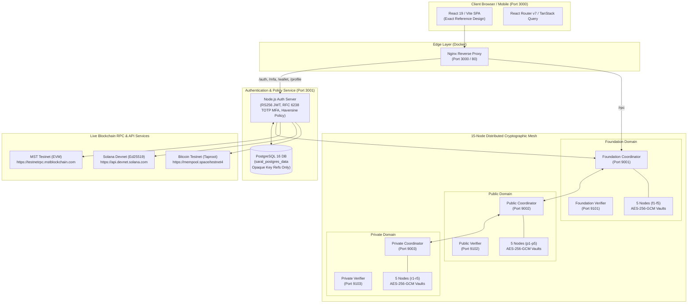
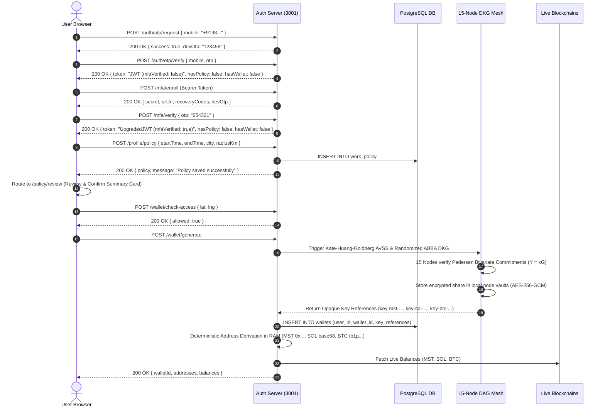
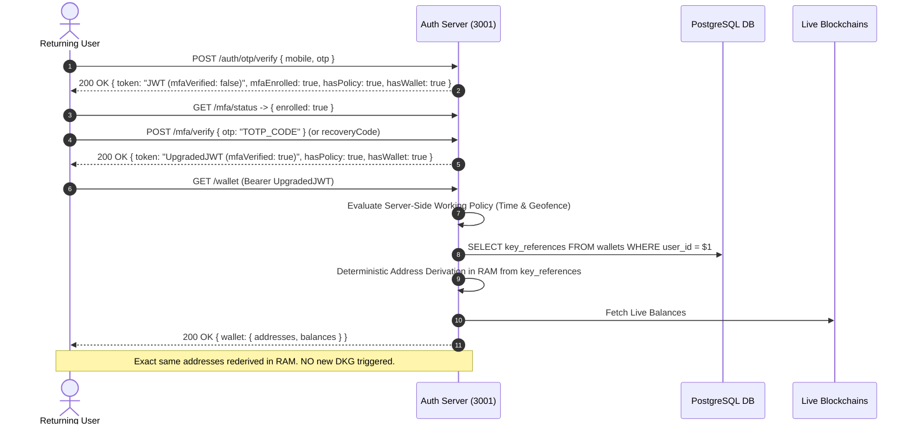

# SARAL PROTOCOL — COMPLETE ARCHITECTURE & SYSTEM SPECIFICATION

> **Authoritative Technical Architecture & System Specification**  
> **Repository Branch:** `saral-dkg`  
> **Status:** Production Verified | 24-Container Mesh | Cryptographic Invariants Preserved  

---

## 1. Executive Summary

**SARAL Protocol** provides a sovereign, distributed, dealerless threshold cryptography Web3 wallet architecture. Private signing keys are never materialized in whole on any single server, database, or client device. Instead, keys are collectively generated and maintained across **15 independent Go nodes** partitioned across three trust domains (**Foundation**, **Public**, and **Private**), mediated by domain coordinators and verifiers.

The architecture strictly guarantees:
- **Clean Minimalist Design:** Exact visual alignment on `#F5F6F8` background, `#FFFFFF` card, and `#0C7A66` green SARAL branding.
- **Mandatory Multi-Factor Authentication (MFA):** Pure RFC 6238 Time-Based One-Time Password (TOTP) enforcement immediately following primary authentication (Google OAuth or mobile phone OTP). Single-use backup recovery codes (`XXXX-XXXX`) and encrypted secret storage at rest using AES-256-GCM.
- **Authoritative Working Policy Engine:** Primary security gate enforced after MFA and evaluated on sensitive operations. Uses authoritative server time, weekday checks, overnight time window calculations, and Haversine distance geofencing with fail-closed security.
- **Zero Central Address Persistence:** Neither blockchain addresses nor private signing keys are ever stored in the central PostgreSQL database or disk. Central storage persists only opaque key references (`key-mst-...`, `key-sol-...`, `key-btc-...`). Addresses are derived on-the-fly in RAM upon authenticated requests satisfying security policies.
- **Single Logical Wallet Invariant:** Exactly one wallet per user (`UNIQUE(user_id)`). Returning users are recognized idempotently, recomputing the exact same addresses on repeat login without ever initiating duplicate DKGs (`MST_Login1 == MST_Login2`, `SOL_Login1 == SOL_Login2`, `BTC_Login1 == BTC_Login2`).
- **Chain-Compatible Address Derivations:**
  - **MST Testnet (EVM):** EIP-55 checksummed `0x...` hex address.
  - **Solana Devnet:** Base58 Ed25519 public key.
  - **Bitcoin Testnet:** BIP-340 / BIP-341 Taproot $X$-only point encoded with BIP-350 Bech32m using testnet HRP `tb1p...`.
- **Docker-Only Persistence & 24-Container Mesh:** Complete containerized deployment defined in `infra/compose/full24.yml` containing exactly 24 services (1 PostgreSQL 16 + 1 Auth Server + 3 Verifiers + 15 Nodes + 3 Coordinators + 1 Web Frontend). Central persistence resides in named volume `saral_postgres_data`; nodes maintain isolated named volumes `node_f1_vault` through `node_r5_vault`.

---

## 2. System Architecture



---

## 3. End-to-End User Journey

### 3.1 First-Time User Onboarding



### 3.2 Returning User Authentication & Idempotent Address Retrieval



---

## 4. Cryptographic Validation & Address Derivation

### 4.1 Unblinded Signing Public Key Derivation ($Y = xG$)
Pedersen commitments have the form:
$$C_{00} = xG + rH$$
Blinded commitments are used strictly for zero-knowledge bivariate polynomial verification during AVSS sharing. The unblinded signing public key is computed as:
$$Y = xG$$
The node verification verifies that $C_{00}$ projects directly to $Y$ when deblinded with commitment blinding factors across participants.

### 4.2 Multi-Chain Derivations

| Blockchain | Curve | Public Key Encoding | Address Derivation Standard | Testnet Address Format |
| :--- | :--- | :--- | :--- | :--- |
| **MST Testnet** | `secp256k1` | 65-byte uncompressed `(0x04 \|\| X \|\| Y)` | $\text{Keccak-256}(pk[1..])[12..31]$ with EIP-55 checksum | `0x[a-fA-F0-9]{40}` |
| **Solana Devnet** | `ed25519` | 32-byte compressed point | Base58 encoding of 32-byte Ed25519 public key | `[1-9A-HJ-NP-Za-km-z]{32,44}` |
| **Bitcoin Testnet** | `secp256k1` | 32-byte $X$-only point | BIP-340 / BIP-341 Taproot output with BIP-350 Bech32m | `tb1p[0-9a-z]{58}` |

---

## 5. Security & Privacy Guarantees

1. **Zero Address Persistence Mandate:**
   - Neither EVM, Solana, nor Bitcoin addresses are stored in the PostgreSQL database or central disk.
   - Central storage maintains only `user_id`, `wallet_id`, and opaque `key_references` (e.g. `key-mst-7d57a501e008f36f`).
   - Addresses are derived deterministically in RAM upon every authenticated, policy-verified request.
2. **Single Logical Wallet Invariant:**
   - Enforced by PostgreSQL `UNIQUE(user_id)` constraint on the `wallets` table.
   - Calling wallet generation multiple times returns the existing wallet reference idempotently.
3. **Fail-Closed Working Policy Engine:**
   - Evaluates IANA timezone-aware start and end times with overnight window support.
   - Evaluates Haversine distance geofence against approved latitude/longitude and radius.
   - Fails closed: requests outside permitted windows or outside approved locations return HTTP 403.
4. **Local Node Vault Protection:**
   - Share scalars are encrypted with AES-256-GCM using hardware-derived node vault keys before local persistence in isolated Docker volumes (`node_f1_vault` .. `node_r5_vault`).

---

## 6. Docker 24-Container Mesh (`infra/compose/full24.yml`)

The production mesh contains exactly 24 interconnected containers on the internal `saral-mesh` bridge network:

| Index | Service | Container Name | Port | Role |
| :--- | :--- | :--- | :--- | :--- |
| 1 | `postgres` | `saral-postgres` | `5432` | PostgreSQL 16 Alpine with `saral_postgres_data` volume |
| 2 | `auth-server` | `saral-prod-auth-server` | `3001` | Asymmetric RS256 JWT, MFA, Working Policy, RAM Address Derivation |
| 3 | `verifier-foundation` | `saral-prod-verifier-foundation` | `9101` | Foundation Token Verification daemon |
| 4 | `verifier-public` | `saral-prod-verifier-public` | `9102` | Public Token Verification daemon |
| 5 | `verifier-private` | `saral-prod-verifier-private` | `9103` | Private Token Verification daemon |
| 6-10 | `node-f1` .. `node-f5` | `saral-prod-node-f1..f5` | `8001` (f1: `8443`) | Foundation domain Go cryptographic nodes (Volumes: `node_f1..f5_vault`) |
| 11-15 | `node-p1` .. `node-p5` | `saral-prod-node-p1..p5` | `8001` | Public domain Go cryptographic nodes (Volumes: `node_p1..p5_vault`) |
| 16-20 | `node-r1` .. `node-r5` | `saral-prod-node-r1..r5` | `8001` | Private domain Go cryptographic nodes (Volumes: `node_r1..r5_vault`) |
| 21 | `coordinator-foundation` | `saral-prod-coord-foundation` | `9001` | Foundation Domain Coordinator |
| 22 | `coordinator-public` | `saral-prod-coord-public` | `9002` | Public Domain Coordinator |
| 23 | `coordinator-private` | `saral-prod-coord-private` | `9003` | Private Domain Coordinator |
| 24 | `web` | `saral-prod-web` | `3000` (`:80`) | Nginx Reverse Proxy & React 19 Frontend Dashboard |

---

## 7. PostgreSQL Database Schema

```sql
-- Core User Account
CREATE TABLE IF NOT EXISTS users (
  id UUID PRIMARY KEY DEFAULT gen_random_uuid(),
  name VARCHAR(255),
  google_id VARCHAR(255) UNIQUE,
  email VARCHAR(255) UNIQUE,
  mobile VARCHAR(50) UNIQUE,
  login_method VARCHAR(50) NOT NULL,
  created_at TIMESTAMP WITH TIME ZONE DEFAULT CURRENT_TIMESTAMP
);

-- MFA Configuration & Status
CREATE TABLE IF NOT EXISTS mfa (
  id UUID PRIMARY KEY DEFAULT gen_random_uuid(),
  user_id UUID NOT NULL REFERENCES users(id) ON DELETE CASCADE,
  type VARCHAR(50) NOT NULL DEFAULT 'totp',
  secret TEXT,
  totp_secret_encrypted TEXT,
  recovery_codes TEXT[],
  recovery_codes_hashed TEXT[],
  verified_at TIMESTAMP WITH TIME ZONE,
  CONSTRAINT unique_user_mfa UNIQUE (user_id)
);

-- Working Policy (Time & Geofence Boundaries)
CREATE TABLE IF NOT EXISTS work_policy (
  id UUID PRIMARY KEY DEFAULT gen_random_uuid(),
  user_id UUID NOT NULL REFERENCES users(id) ON DELETE CASCADE,
  start_time VARCHAR(10) NOT NULL,
  end_time VARCHAR(10) NOT NULL,
  timezone VARCHAR(100) NOT NULL DEFAULT 'Asia/Kolkata',
  city VARCHAR(255) NOT NULL,
  lat DOUBLE PRECISION NOT NULL,
  lng DOUBLE PRECISION NOT NULL,
  radius_km DOUBLE PRECISION NOT NULL DEFAULT 25.0,
  time_restriction_enabled BOOLEAN NOT NULL DEFAULT TRUE,
  location_restriction_enabled BOOLEAN NOT NULL DEFAULT FALSE,
  geofence_enabled BOOLEAN NOT NULL DEFAULT FALSE,
  set_at TIMESTAMP WITH TIME ZONE DEFAULT CURRENT_TIMESTAMP,
  CONSTRAINT unique_user_work_policy UNIQUE (user_id)
);

-- Distributed Wallet Metadata (NO Addresses, NO Private Keys)
CREATE TABLE IF NOT EXISTS wallets (
  id UUID PRIMARY KEY DEFAULT gen_random_uuid(),
  user_id UUID NOT NULL REFERENCES users(id) ON DELETE CASCADE,
  wallet_id VARCHAR(100) NOT NULL UNIQUE,
  status VARCHAR(50) NOT NULL DEFAULT 'CREATING',
  key_references JSONB NOT NULL DEFAULT '{}'::jsonb,
  created_at TIMESTAMP WITH TIME ZONE DEFAULT CURRENT_TIMESTAMP,
  updated_at TIMESTAMP WITH TIME ZONE DEFAULT CURRENT_TIMESTAMP,
  CONSTRAINT unique_user_wallet UNIQUE (user_id)
);

-- Access Evaluation Audit Log
CREATE TABLE IF NOT EXISTS access_logs (
  id UUID PRIMARY KEY DEFAULT gen_random_uuid(),
  user_id UUID NOT NULL REFERENCES users(id) ON DELETE CASCADE,
  attempted_at TIMESTAMP WITH TIME ZONE DEFAULT CURRENT_TIMESTAMP,
  lat DOUBLE PRECISION,
  lng DOUBLE PRECISION,
  allowed BOOLEAN NOT NULL,
  reason TEXT NOT NULL
);
```

---

## 8. Verification Commands

### 8.1 Docker Compose 24-Container Mesh

```bash
# Start the full 24-container mesh in background
docker compose -f infra/compose/full24.yml up -d --build

# Verify container health
docker compose -f infra/compose/full24.yml ps

# Access the Web Application
# Browser: http://localhost:3000
# Auth Server: http://localhost:3001
# Foundation Coordinator: http://localhost:9001
```

### 8.2 Automated Test Execution

```bash
# Run Vitest SDK and Architecture Tests
npm test

# Run Go Cryptographic Architecture Tests
go test -v ./tests/architecture/...

# Run End-to-End System Verification
node scratch/test_full_v3_e2e.js
```
