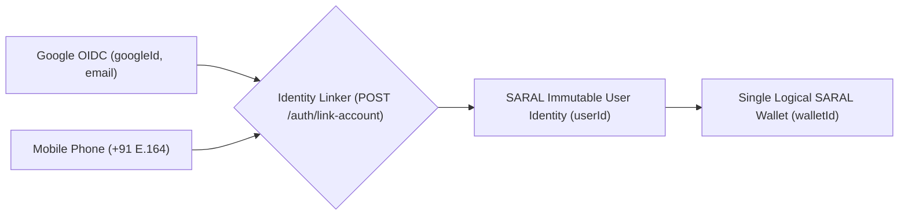

# SARAL PROTOCOL V3 — AUTHENTICATION, ACCOUNT LINKING & MFA SPECIFICATION

**Document ID:** `SARAL-SEC-V3-AUTH-002`  
**Classification:** Security Architecture & Cryptographic Protocols  
**Branch:** `saral-dkg`  
**Status:** Formally Verified  
**Date:** November 19, 2026  

---

## 1. PRIMARY AUTHENTICATION

SARAL Protocol V3 supports two primary authentication options mapping to an immutable internal user identity (`userId`).

### 1.1 Option A: Google Sign-In (OpenID Connect)
- Server-side token verification validating issuer (`accounts.google.com`), audience (`GOOGLE_CLIENT_ID`), expiration, subject (`googleId`), and email.
- Never trusts client-supplied user identity claims directly.
- Issues a temporary primary token with claim `"mfaVerified": false`.

### 1.2 Option B: Mobile Phone OTP
- **Phone Normalization:** E.164 standard formatting (e.g. `+919876543210`).
- **Cryptographic OTP Generation:** CSPRNG via `crypto.randomInt(100000, 1000000)` producing 6-digit challenge.
- **HMAC-SHA256 Storage:** Plaintext OTPs are NEVER written to disk or database. The challenge is stored as:
  $$\text{CodeHash} = \text{HMAC-SHA256}(\text{Pepper}, \text{userId} \parallel \text{purpose} \parallel \text{OTP})$$
- **Timing-Safe Verification:** Evaluated with `crypto.timingSafeEqual` over hex digest buffers.
- **Abuse Prevention:**
  - 10-minute expiration window.
  - Per-number resend cooldown (30 seconds).
  - Maximum 5 failed attempts per challenge; upon the 5th failure, the challenge is immediately burned (`used: true`).
  - Zero OTP logging in production logs.

---

## 2. EXPLICIT ACCOUNT IDENTITY LINKING

Google and Phone OTP serve as alternative access vectors to the SAME underlying SARAL user:



### Security Rules for Account Linking:
1. **Authenticated Step-Up Required:** A user must already be authenticated and verified via second-factor MFA to initiate account linking.
2. **Collision Prevention:** If a target credential (e.g. phone number or Google ID) is already bound to another existing `userId` with an active wallet, linking is **strictly rejected**.
3. **Deterministic Wallet Access:** Linking never creates a second wallet; the user retains their single established wallet.

---

## 3. SECOND-FACTOR MULTI-FACTOR AUTHENTICATION (MFA)

### 3.1 RFC 6238 Time-Based One-Time Password (TOTP)
- **Secret Generation:** 160-bit (20 bytes) base32 random secret generated via CSPRNG.
- **Encryption at Rest:** Secrets are stored in `DataStore` encrypted with AES-256-GCM using a dedicated scrypt-derived master key (`MFA_ENCRYPTION_KEY`).
- **Time Window & Drift:** Standard 30-second time steps. The verification engine checks current counter $T_0$, past window $T_0 - 1$, and future window $T_0 + 1$ to allow for clock drift without compromising security.

### 3.2 Single-Use Backup Recovery Codes
- During enrollment, 8 backup recovery codes are generated (format: `XXXX-XXXX`).
- Plaintext codes are presented to the operator exactly once during enrollment.
- Only **SHA-256 hashes** of the codes are persisted in the database:
  $$\text{RecoveryHash} = \text{SHA-256}(\text{Code})$$
- When a recovery code is successfully presented, its hash is immediately burned (deleted from the active array). Replay attempts fail uniformly.

### 3.3 Rate Limiting & Account Lockout
- Failed MFA verification attempts are tracked in memory.
- 5 consecutive failures trigger an automatic 15-minute temporary security lockout.

---

## 4. ASYMMETRIC RS256 SESSION TOKENS

Upon successful MFA completion, the Auth Server issues an upgraded RS256 JWT signed with its RSA-2048 private key:

```json
{
  "sub": "user-uuid-1234",
  "iss": "saral-auth-server",
  "aud": "saral-domain-coordinators",
  "iat": 1731952000,
  "exp": 1731955600,
  "mfaVerified": true,
  "domainRole": "operator",
  "nonce": "a1b2c3d4e5f6..."
}
```

The 3 domain verifiers and coordinators validate this token against the Auth Server's public key (`/auth/public-key`) without needing access to any database.
