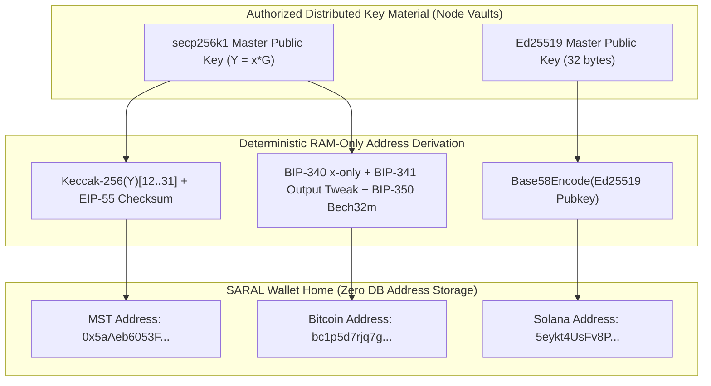

# SARAL PROTOCOL V3 — MULTI-CHAIN ADDRESS DERIVATION & CURVE COMPLIANCE

**Document ID:** `SARAL-CRYPTO-V3-MULTICHAIN-005`  
**Classification:** Cryptographic Standards & Address Derivation  
**Branch:** `saral-dkg`  
**Status:** Formally Verified  
**Date:** November 19, 2026  

---

## 1. SUPPORTED CHAINS & CRYPTOGRAPHIC ALIGNMENT

SARAL Protocol V3 exposes exactly three supported blockchain ecosystems in the user interface:
1. **MST Blockchain** (EVM Compatible Sovereign Chain)
2. **Solana** (High-Performance Layer 1)
3. **Bitcoin Taproot** (SegWit v1 / BIP-340 / BIP-341)

---

## 2. DERIVATION SPECIFICATIONS BY CHAIN

### 2.1 Chain A: MST Blockchain (EVM Compatible)
- **Cryptographic Curve:** `secp256k1`
- **Public Key Format:** 64-byte uncompressed elliptic curve point $(X \parallel Y)$
- **Hashing:** Keccak-256
- **Address Generation:**
  $$\text{RawAddress} = \text{Keccak-256}(X \parallel Y)[12..31] \quad (20 \text{ bytes})$$
- **Checksum Encoding (EIP-55):**
  Capitalization of each alphabetic character in the hex string is determined by the corresponding nibble of $\text{Keccak-256}(\text{lowercaseAddress})$.
- **Verification Rule:** Never derive ordinary EVM EOA addresses from NIST P-256 points.

### 2.2 Chain B: Solana
- **Cryptographic Curve:** `ed25519`
- **Public Key Format:** 32-byte compressed point on Curve25519 / Edwards-curve.
- **Encoding:** Base58 encoding using the 58-character alphanumeric alphabet:
  `123456789ABCDEFGHJKLMNPQRSTUVWXYZabcdefghijkmnopqrstuvwxyz`
- **Output:** Standard 32–44 character Solana address string (e.g. `5eykt4UsFv8P8NJdTREpY1vzqKqZKvdpKuc147dw2N9d`).

### 2.3 Chain C: Bitcoin Taproot (SegWit v1)
- **Cryptographic Curve:** `secp256k1`
- **Public Key Format:** BIP-340 32-byte $x$-only public key $P$ with even-$Y$ coordinate parity:
  $$P = x \cdot G, \quad \text{has\_even\_y}(P) = \text{true}$$
- **BIP-341 Taproot Output Key Tweaking:**
  $$t = \text{TaggedHash}_{\text{TapTweak}}(P \parallel \text{merkle\_root})$$
  $$Q = P + t \cdot G$$
- **BIP-350 Bech32m Encoding:**
  - Witness Version: `1`
  - Human-Readable Prefix (HRP): `bc` (Mainnet) or `tb` (Testnet)
  - Bech32m generator polynomial constant: `0x2bc830a3`
- **Output Format:** `bc1p[58 characters]`

---

## 3. ZERO-ADDRESS DATABASE INVARIANT

- The central database (`DataStore`) contains **NO columns or fields** for `mst_address`, `solana_address`, `bitcoin_address`, or public keys.
- Addresses are derived deterministically on-demand in server RAM only after:
  1. Validating bearer token authentication
  2. Verifying second-factor MFA
  3. Evaluating Working Policy (time & geofence)
- Recomputation produces the exact same address on every login because the key references and node DKG commitments are mathematically immutable.
