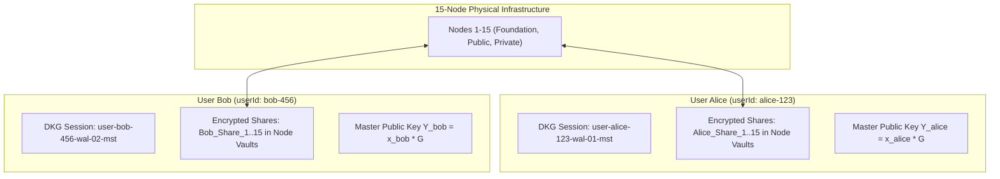

# SARAL PROTOCOL V3 — PER-USER DKG & VAULT ISOLATION SPECIFICATION

**Document ID:** `SARAL-CRYPTO-V3-DKG-004`  
**Classification:** Cryptographic Protocols & Vault Security  
**Branch:** `saral-dkg`  
**Status:** Formally Verified  
**Date:** November 19, 2026  

---

## 1. THE PER-USER DKG MANDATE: ZERO SHARED USER KEYS

In multi-tenant institutional cryptographic custody, using a single shared master DKG key for all users is a fatal flaw. While SARAL Protocol V3 leverages a shared infrastructure committee (the 15 Go nodes across Foundation, Public, and Private domains), **each user wallet possesses an independently generated, cryptographically isolated distributed key**.

---

## 2. DKG SESSION IDENTIFIER BINDING

Every DKG execution and resulting vault record is bound to an immutable composite identifier:
$$\text{SessionID} = \text{"user-" } \parallel \text{userId} \parallel \text{"-wal-" } \parallel \text{walletId} \parallel \text{"-" } \parallel \text{chainFamily}$$

Where:
- `userId`: Immutable UUID of the authenticated SARAL user.
- `walletId`: Unique logical wallet UUID.
- `chainFamily`: Target cryptographic chain family (`mst`, `solana`, `bitcoin`).
- `committeeId`: Identifier of the executing node group (e.g., `global-committee-15`).
- `epoch`: Share generation epoch (starting at 1).

A user cannot request another user's key material by tampering with URL parameters or JSON fields because every node request requires a verifier-checked bearer token carrying the authenticated `userId`.

---

## 3. VAULT ENCRYPTION & LOCAL ON-DISK STORAGE

Each of the 15 Go nodes stores secret shares inside its private vault:
- **Location:** `services/saral-node/vault/`
- **File Permissions:** POSIX `0600` (read/write owner only); directories `0700`.
- **Encryption Scheme:** Authenticated AES-256-GCM.
- **Key Derivation:** Per-node 32-byte key derived with `scrypt` from the node's local private identity key:
  $$\text{VaultKey} = \text{scrypt}(\text{NodeIdentitySecret}, \text{Salt}, N=16384, r=8, p=1)$$
- **Additional Authenticated Data (AAD):** Binds `walletId`, `epoch`, and `nodeId` directly into the AES-GCM tag:
  $$\text{AAD} = \text{"SARAL\_AAD:"} \parallel \text{walletId} \parallel \text{":EPOCH\_"} \parallel \text{epoch} \parallel \text{":"} \parallel \text{nodeId}$$
  This mathematically guarantees that an encrypted share cannot be copied or substituted into another user's wallet partition.

---

## 4. NO MASTER PRIVATE KEY RECONSTRUCTION

Under standard operation:
- Neither the user's browser, nor the coordinator, nor the authentication server ever receives or reconstructs the master secret $x$.
- Private shares $s_i$ remain permanently distributed within node memory/vaults.
- Public signing keys ($Y = xG$) and addresses are derived from audited public commitments without secret share aggregation.
