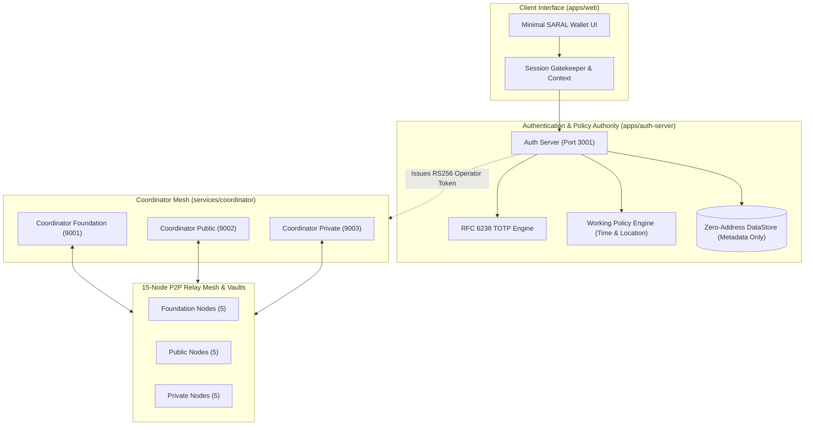

# SARAL PROTOCOL V3 — WALLET ARCHITECTURE & SYSTEM SPECIFICATION

**Document ID:** `SARAL-ARCH-V3-WALLET-001`  
**Classification:** System Architecture & Cryptographic Engineering  
**Branch:** `saral-dkg`  
**Status:** Formally Verified  
**Date:** November 19, 2026  

---

## 1. ARCHITECTURAL OVERVIEW & SEPARATION OF POWERS

The SARAL Protocol V3 architecture enforces a strict **Separation of Powers** across three autonomous administrative domains:
- **Foundation Domain** (5 Go Nodes, 1 Coordinator, 1 Verifier)
- **Public Domain** (5 Go Nodes, 1 Coordinator, 1 Verifier)
- **Private Domain** (5 Go Nodes, 1 Coordinator, 1 Verifier)

Total: **15 independent node processes, 3 domain coordinators, 3 token verifiers, 1 asymmetric authentication server, and 1 client dashboard**.



---

## 2. THE END-TO-END ONBOARDING & RETURNING USER LIFECYCLE

### 2.1 First-Time User Journey
$$\text{Welcome / Login} \longrightarrow \text{Google OIDC / Phone OTP} \longrightarrow \text{TOTP MFA Setup} \longrightarrow \text{Working Policy Setup} \longrightarrow \text{Per-User DKG} \longrightarrow \text{Deterministic Address Derivation} \longrightarrow \text{Wallet Home}$$

1. **Primary Authentication:**
   - Option A: Google OIDC with server-side validation.
   - Option B: Mobile phone number (+91 E.164) with 6-digit cryptographic HMAC-SHA256 OTP challenge.
2. **Second-Factor MFA Enrollment:**
   - RFC 6238 TOTP secret generated (20-byte base32).
   - Secret encrypted at rest with AES-256-GCM.
   - 8 one-time backup recovery codes issued; only SHA-256 hashes are stored.
3. **Working Policy Setup:**
   - Time window (e.g. 09:00 - 18:00), allowed weekdays, IANA timezone (e.g. `Asia/Kolkata`).
   - Location geofence (GPS coordinates, allowed radius in km/meters).
4. **Per-User DKG & Address Derivation:**
   - Creates exactly one logical wallet record: `{ userId, walletId, status: "READY", keyReferences }`.
   - Generates multi-chain public keys without private key reconstruction.
   - Returns addresses in RAM.

### 2.2 Returning User Journey
$$\text{Login} \longrightarrow \text{MFA Verification} \longrightarrow \text{Working Policy Evaluation} \longrightarrow \text{Node Key Verification} \longrightarrow \text{Deterministic Address Recomputation} \longrightarrow \text{Wallet Home}$$

- A returning user **NEVER** silently generates a new wallet.
- The system checks if `store.getWalletByUserId(userId)` exists.
- If it exists, the existing immutable `walletId` and `keyReferences` are loaded.
- Addresses are recomputed deterministically in RAM matching the exact same addresses from creation.

---

## 3. STRICT PERSISTENCE GUARANTEES: ZERO WALLET ADDRESS STORAGE

### 3.1 The Vulnerability of Address Persistence in Central Databases
Storing blockchain addresses, unblinded public keys, or encrypted private shares in central application databases creates a severe systemic target. In multi-tenant systems, database compromises leak wallet topologies, user activity correlations, and metadata linkages.

### 3.2 SARAL Zero-Address Architecture
In SARAL Protocol V3, the application database stores **ZERO** wallet addresses, **ZERO** blockchain public keys, and **ZERO** private shares:

```json
{
  "userId": "9b1deb4d-3b7d-4bad-9bdd-2b0d7b3dcb6d",
  "walletId": "wal-8f14b3c2-d021-4f9e-a812-78d10b7b6e92",
  "status": "READY",
  "keyReferences": {
    "mst": "key-mst-a4c8e192f03b",
    "solana": "key-sol-b9d10e823f41",
    "bitcoin": "key-btc-c3a7d219e480"
  },
  "createdAt": "2026-11-19T00:46:00.000Z",
  "updatedAt": "2026-11-19T00:46:00.000Z"
}
```

- Key shares reside exclusively within local encrypted node vaults (`services/saral-node/vault/`) with 0600 file modes and scrypt-derived AES-256-GCM encryption.
- Addresses are derived deterministically on-the-fly in RAM upon authenticated request and returned via HTTPS to the client.

---

## 4. STRICT ONE-USER-ONE-WALLET RULE

1. **Transactional Invariant:** Exactly ONE logical wallet may exist for any internal `userId`.
2. **Idempotent Creation State Machine:** Concurrent creation requests or page reloads resolve to the existing wallet record.
3. **Immutable Identity Binding:** Account linking (merging Google and Phone credentials) points to the same `userId` and therefore resolves to the same single wallet.

---

## 5. SCOPE & PHASE BOUNDARIES

- **Current Scope:** User registration, multi-factor authentication, working policy enforcement, per-user DKG orchestration, multi-chain public address derivation (MST, Solana, Bitcoin Taproot), and minimal wallet home view.
- **Strictly Excluded (Phase 4):** Threshold transaction signing (`signTransaction`), token transfers, swaps, staking, withdrawals, and blockchain broadcasts.
- All TSS endpoints remain disabled and return `-32000 NOT_IMPLEMENTED`.
