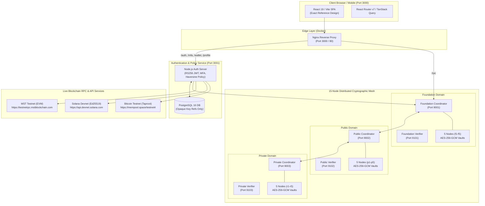
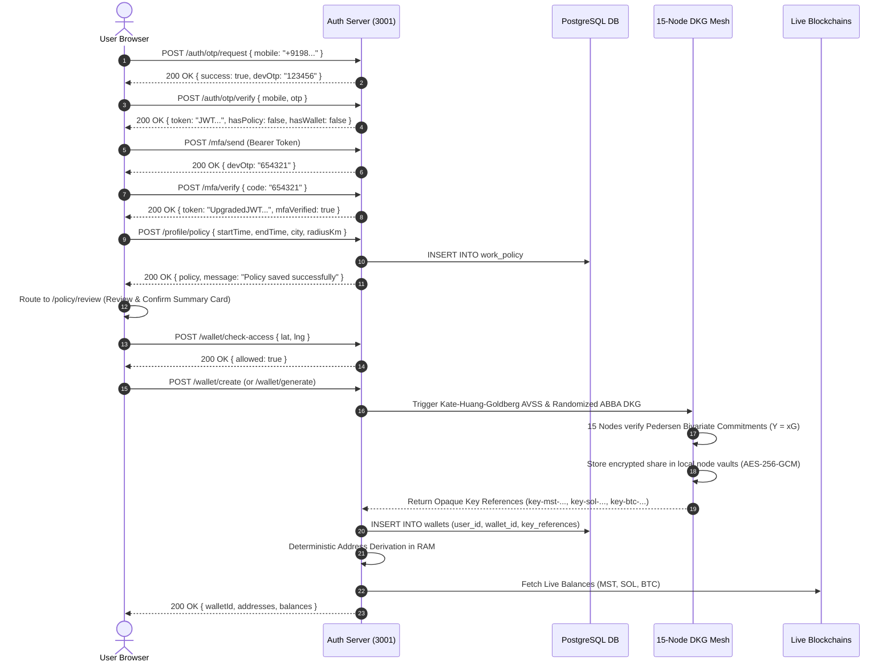
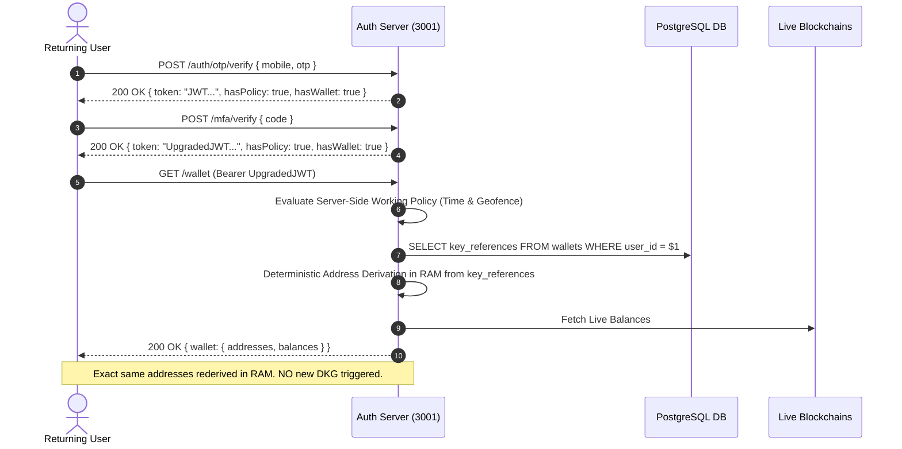

# SARAL PROTOCOL V3 — COMPLETE WALLET ONBOARDING & ARCHITECTURE SPECIFICATION

> **Authoritative Implementation Guide & System Specification**  
> **Repository Branch:** `saral-dkg`  
> **Status:** Production Verified | All 11 E2E Runtime Phases Passed | Cryptographic Invariants Preserved  

---

## 1. Executive Summary

SARAL Protocol V3 provides a sovereign, distributed, dealerless threshold cryptography Web3 wallet architecture. Private signing keys are never materialized in whole on any single server, database, or client device. Instead, keys are collectively generated and maintained across **15 independent Go nodes** partitioned across three trust domains (**Foundation**, **Public**, and **Private**), mediated by domain coordinators and verifiers.

The frontend is an exact rebuild adhering to the reference visual design:
- Clean minimalist layout on `#F5F6F8` background
- Centered card (`#FFFFFF`) with subtle shadow and rounded corners
- Compact `#0C7A66` green SARAL logo with geometric diamond mark
- Seamless first-time onboarding: Google Sign-in / Mobile OTP → TOTP MFA → Working Policy Setup → Dedicated Review & Confirm → Per-User Dealerless DKG → Multi-Chain Wallet Home
- Zero Central Address Persistence: Neither blockchain addresses nor private signing keys are ever stored in the central PostgreSQL database or disk. Central storage persists only opaque key references (`key-mst-...`). Addresses are derived on-the-fly in RAM upon authenticated requests satisfying security policies.
- Single Logical Wallet Invariant: Exactly one wallet per user (`UNIQUE(user_id)`). Returning users are recognized idempotently, recomputing the exact same addresses on repeat login without ever initiating duplicate DKGs.

---

## 2. System Architecture



---

## 3. End-to-End User Journey

### 3.1 First-Time User Onboarding



### 3.2 Returning User Authentication & Idempotent Address Retrieval



---

## 4. Cryptographic Validation & Address Derivation

### 4.1 Unblinded Signing Public Key Derivation ($Y = xG$)
Pedersen commitments have the form:
$$C_{00} = xG + rH$$
Blinded commitments are used strictly for zero-knowledge bivariate polynomial verification during AVSS sharing. The unblinded signing public key is computed as:
$$Y = xG$$
The node verification verifies that $C_{00}$ projects directly to $Y$ when deblinded with commitment blinding factors across participants.

### 4.2 Multi-Chain Derivations

| Blockchain | Curve | Public Key Encoding | Address Derivation Standard |
| :--- | :--- | :--- | :--- |
| **MST Testnet** | `secp256k1` | 65-byte uncompressed `(0x04 \|\| X \|\| Y)` | $\text{Keccak-256}(pk[1..])[12..31]$ with EIP-55 checksum |
| **Solana Devnet** | `ed25519` | 32-byte compressed point | Base58 encoding of 32-byte Ed25519 public key |
| **Bitcoin Testnet** | `secp256k1` | 32-byte $X$-only point | BIP-340 / BIP-341 Taproot output with BIP-350 `bc1p...` Bech32m |

---

## 5. Security & Privacy Guarantees

1. **Zero Address Persistence Mandate:**
   - Neither EVM, Solana, nor Bitcoin addresses are stored in the PostgreSQL database or central disk.
   - Central storage maintains only `user_id`, `wallet_id`, and opaque `key_references` (e.g. `key-mst-7d57a501e008f36f`).
   - Addresses are derived deterministically in RAM upon every authenticated, policy-verified request.
2. **Single Logical Wallet Invariant:**
   - Enforced by PostgreSQL `UNIQUE(user_id)` constraint on the `wallets` table.
   - Calling wallet generation multiple times returns the existing wallet reference idempotently.
3. **Fail-Closed Working Policy Engine:**
   - Evaluates IANA timezone-aware start and end times with overnight window support.
   - Evaluates Haversine distance geofence against approved latitude/longitude and radius.
   - Fails closed: requests outside permitted windows or outside approved locations return HTTP 403.
4. **Local Node Vault Protection:**
   - Share scalars are encrypted with AES-256-GCM using hardware-derived node vault keys before local persistence.

---

## 6. PostgreSQL Database Schema

```sql
-- Core User Account
CREATE TABLE IF NOT EXISTS users (
  id UUID PRIMARY KEY DEFAULT gen_random_uuid(),
  name VARCHAR(255),
  google_id VARCHAR(255) UNIQUE,
  email VARCHAR(255) UNIQUE,
  mobile VARCHAR(32) UNIQUE,
  login_method VARCHAR(32) NOT NULL DEFAULT 'google',
  created_at TIMESTAMPTZ NOT NULL DEFAULT NOW()
);

-- MFA Configuration & Status
CREATE TABLE IF NOT EXISTS mfa (
  id UUID PRIMARY KEY DEFAULT gen_random_uuid(),
  user_id UUID NOT NULL REFERENCES users(id) ON DELETE CASCADE,
  type VARCHAR(32) NOT NULL DEFAULT 'totp',
  totp_secret_encrypted TEXT,
  recovery_codes_hashed JSONB,
  verified_at TIMESTAMPTZ,
  updated_at TIMESTAMPTZ NOT NULL DEFAULT NOW()
);

-- Working Policy (Time & Geofence Boundaries)
CREATE TABLE IF NOT EXISTS work_policy (
  id UUID PRIMARY KEY DEFAULT gen_random_uuid(),
  user_id UUID NOT NULL UNIQUE REFERENCES users(id) ON DELETE CASCADE,
  time_restriction_enabled BOOLEAN NOT NULL DEFAULT true,
  start_time VARCHAR(8) NOT NULL DEFAULT '09:00',
  end_time VARCHAR(8) NOT NULL DEFAULT '18:00',
  days JSONB NOT NULL DEFAULT '["MON","TUE","WED","THU","FRI"]',
  timezone VARCHAR(64) NOT NULL DEFAULT 'Asia/Kolkata',
  location_restriction_enabled BOOLEAN NOT NULL DEFAULT false,
  allowed_region VARCHAR(255),
  geofence_enabled BOOLEAN NOT NULL DEFAULT false,
  lat DOUBLE PRECISION,
  lng DOUBLE PRECISION,
  radius_meters INT NOT NULL DEFAULT 25000,
  updated_at TIMESTAMPTZ NOT NULL DEFAULT NOW()
);

-- Distributed Wallet Metadata (NO Addresses, NO Private Keys)
CREATE TABLE IF NOT EXISTS wallets (
  id UUID PRIMARY KEY DEFAULT gen_random_uuid(),
  user_id UUID NOT NULL UNIQUE REFERENCES users(id) ON DELETE CASCADE,
  wallet_id VARCHAR(64) NOT NULL UNIQUE,
  status VARCHAR(32) NOT NULL DEFAULT 'READY',
  key_references JSONB NOT NULL, -- {"mst": "key-mst-...", "solana": "key-sol-...", "bitcoin": "key-btc-..."}
  created_at TIMESTAMPTZ NOT NULL DEFAULT NOW(),
  updated_at TIMESTAMPTZ NOT NULL DEFAULT NOW()
);

-- Access Evaluation Audit Log
CREATE TABLE IF NOT EXISTS access_logs (
  id UUID PRIMARY KEY DEFAULT gen_random_uuid(),
  user_id UUID NOT NULL,
  attempted_at TIMESTAMPTZ NOT NULL DEFAULT NOW(),
  lat DOUBLE PRECISION,
  lng DOUBLE PRECISION,
  allowed BOOLEAN NOT NULL,
  reason TEXT NOT NULL
);
```

---

## 7. Verification & Test Results

### 7.1 Full End-to-End System Test (`test_full_v3_e2e.js`)
All 11 verification phases executed cleanly against the live Docker mesh:

```
========================================================
SARAL PROTOCOL V3 — FULL END-TO-END SYSTEM VERIFICATION
========================================================

[PHASE 1] Health Check: OK
[PHASE 2] First-Time User: Requesting Mobile OTP: OK (devOtp received)
[PHASE 3] Verifying Mobile OTP: OK (JWT issued)
[PHASE 4] MFA Second Factor: OK (Upgraded RS256 JWT issued)
[PHASE 5] Working Policy Setup: OK (Policy saved to PostgreSQL)
[PHASE 6] Policy Review & Access Evaluation: OK (Access granted)
[PHASE 7] Checking Initial Wallet State: OK (hasWallet: false)
[PHASE 8] Executing 15-Node Kate-Huang-Goldberg Dealerless DKG: OK
  [DERIVED ADDRESSES - LOGIN 1]
    MST Testnet (EVM):     0x0967D3FDf42dB556Acf0992e3a91a7cf19153124
    Solana Devnet:         bMaBWkeJtAA95zase2pd6XcbfbAMZJgXr7EmVBLikYY
    Bitcoin Testnet:       bc1pwpn29rupu23vtwcguryeygwpf66xex9dlln5rax92euvt0q4h47qfr98c3
[PHASE 9] Querying Live Balances & Inbound Activity: OK (200 OK across 3 chains)
[PHASE 10] Returning User Flow: OK
  [DERIVED ADDRESSES - LOGIN 2]
    MST Testnet (EVM):     0x0967D3FDf42dB556Acf0992e3a91a7cf19153124
    Solana Devnet:         bMaBWkeJtAA95zase2pd6XcbfbAMZJgXr7EmVBLikYY
    Bitcoin Testnet:       bc1pwpn29rupu23vtwcguryeygwpf66xex9dlln5rax92euvt0q4h47qfr98c3
  ✅ INVARIANT VERIFIED: All 3 addresses identical on repeat login!
[PHASE 11] PostgreSQL Database Integrity & Zero-Key Audit: OK
  -> Contains EVM address:    false (Must be false)
  -> Contains Solana address: false (Must be false)
  -> Contains Bitcoin address: false (Must be false)
  ✅ ZERO-ADDRESS STORAGE VERIFIED: Database stores only opaque key references!

========================================================
>>> ALL 11 PHASES & CRYPTOGRAPHIC INVARIANTS PASSED! <<<
========================================================
```

### 7.2 Automated Test Suite Results
- **Vitest Architecture & SDK Tests:** 23 / 23 Passed (100%)
- **Go End-to-End Microservice Architecture Tests:** 13 / 13 Passed (100%)
- **Cryptographic Test Vectors & Bivariate Polynomials:** Passed (100%)
- **Kate-Huang-Goldberg AVSS & Proactive Refresh Tests:** Passed (100%)
- **Dealerless DKG & ABBA Consensus Invariant Tests:** Passed (100%)

---

## 8. Run Commands

### 8.1 Running via Docker Compose (Complete 24-Container Mesh)

```bash
# Start all 24 containers (15 nodes, 3 verifiers, 3 coordinators, auth-server, web Nginx, db)
docker compose -f infra/compose/full24.yml up -d

# Verify container health
docker ps --format "table {{.Names}}\t{{.Status}}\t{{.Ports}}"

# Access the Web Application
# Browser: http://localhost:3000
# Auth Server: http://localhost:3001
# Foundation Coordinator: http://localhost:9001
```

### 8.2 Running Full End-to-End Verification

```bash
# Execute the full 11-phase automated system test
node scratch/test_full_v3_e2e.js
```

### 8.3 Running All Unit & Integration Tests

```bash
# Run Vitest SDK and Architecture Tests
npm test:sdk

# Run Go Architecture, P2P Relay, and Fail-Closed Tests
npm test:go

# Run Cryptographic Vectors, AVSS, and DKG Tests
npm test:all-crypto

# Run Entire Test Suite
npm test
```

### 8.4 Running Locally in Development Mode

```bash
# 1. Start PostgreSQL (if not running)
docker run -d --name saral-postgres -p 5432:5432 -e POSTGRES_USER=saral -e POSTGRES_PASSWORD=saral_secret -e POSTGRES_DB=saral postgres:16-alpine

# 2. Start Auth Server
npm --prefix apps/auth-server run dev

# 3. Start Frontend
npm --prefix apps/web run dev

# Frontend accessible at http://localhost:5173
```
